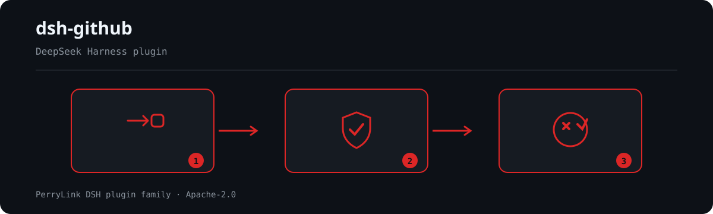

<div align="center">

# dsh-github

> Release stamp: `0.7.16` (2026-10-04).

> **Nombre del paquete.** Este proyecto se publica en npm como **`@perrylink/dsh-github`**. El nombre simple `dsh-github` pertenece a otro proyecto no relacionado: instalarlo no instala este plugin.

**PRs, revisiones, issues y CI de GitHub para DeepSeek Harness — cada escritura aprobada por un humano y el token nunca registrado.**

*Crea, revisa, fusiona y busca en GitHub desde el agente, con una acción compuesta de CI, un bot de revisión por sondeo y una puerta de status-check.*

[](LICENSE)
[](https://gitee.com/perrylink/dsh-github)
[](https://github.com/topics/dsh-plugin)
[](https://github.com/PerryLink/dsh-plugin-doctor#verified-徽章)
[](https://dsh.market/)
[](#)
[](https://github.com/PerryLink/dsh-github/actions)
[](https://github.com/PerryLink/dsh-github/releases)
[](https://www.npmjs.com/package/@perrylink/dsh-github)
- **Canal 1024 store**: `npm i -g dsh1024` una vez, luego `dsh1024 plugin --profile web add @perrylink/dsh-github` (cuenta para el ranking de instalaciones de [deepseek1024.com](https://deepseek1024.com)).
[](https://www.npmjs.com/package/@perrylink/dsh-github)
[](https://dshfind.com/es/plugins/PerryLink/dsh-github?ref=badge)

[English](README.md) · [简体中文](README-zh.md) · [Español](README-es.md) · [Português](README-pt.md) · [हिन्दी](README-hi.md)

```sh
dsh plugin --profile <name> add @perrylink/dsh-github
```


</div>

---

## Instalación y desinstalación

- **canal git** (último `main`): `dsh plugin --profile web add github:PerryLink/dsh-github` — el script `prepare` compila solo con dependencias de producción.
- **canal npm** (versiones publicadas): `dsh plugin --profile web add @perrylink/dsh-github`.
- **canal tarball**: `pnpm pack` en este repositorio y luego `dsh plugin --profile web add ./perrylink-dsh-github-<version>.tgz`.
- **desinstalar**: `dsh plugin --profile web remove @perrylink/dsh-github` (o elimina la fila del parche de perfil).

## What is dsh-github?

PRs, revisiones, issues y CI de GitHub para DeepSeek Harness — cada escritura aprobada por un humano y el token nunca registrado.

Crea, revisa, fusiona y busca en GitHub desde el agente, con una acción compuesta de CI, un bot de revisión por sondeo y una puerta de status-check.



*Resumen del flujo: solicitud → política/revisión → veredicto. Los ejemplos siguientes usan la superficie de comandos real.*


*La misma ejecución, animada.*

## 📚 Tabla de contenidos

- [What is dsh-github?](#what-is-dsh-github)
- [Compatibilidad](#compatibilidad)
- [Qué obtienes](#qué-obtienes)
- [Inicio rápido](#inicio-rápido)
- [Instalación y desinstalación](#instalación-y-desinstalación)
- [Configuración](#configuración)
- [Herramientas y superficies](#herramientas-y-superficies)
- [Arquitectura](#arquitectura)
- [Permisos y datos](#permisos-y-datos)
- [Límites de seguridad](#límites-de-seguridad)
- [Limitaciones conocidas](#limitaciones-conocidas)
- [Desarrollo](#desarrollo)
- [Estructura del repositorio](#estructura-del-repositorio)
- [Temas](#temas)
- [Contribuidores](#contribuidores)
- [Familia de plugins DSH de PerryLink](#perrylink-dsh-plugin-family)
- [Licencia](#licencia)

- [Interoperabilidad con otros plugins de DSH](#interoperabilidad-con-otros-plugins-de-dsh)
## Compatibilidad

| Superficie | Estado |
|---|---|
| Harness | DeepSeek Harness `dsh-v0.2.1-rc.2` (verificado 2026-10-18): `engines.dsh >=0.2.1-0 <0.3.0`; las rutas de compatibilidad P0 tienen pruebas de regresión. |
| Node | `^22.19.0 \|\| >=24.0.0` |
| Plataformas | Todas (plugin host; red saliente a GitHub) |
| Modelo | Cualquiera (la revisión estática es determinista; `reviewMode: "model"` es opcional) |

## Qué obtienes

`dsh-github` cubre el vacío de GitHub entre `dsh` y herramientas como Claude Code y Codex: tu agente puede leer, revisar, abrir, actualizar y fusionar pull requests, leer metadatos de repositorios y archivos, comentar y cerrar issues, y buscar — mientras un humano aprueba cada escritura y el token permanece en secreto.

- **14 herramientas** — `pr_create`, `pr_merge`, `pr_update`, `gh_review`, `review_post`, `gh_issue`, `issue_open`, `issue_comment`, `issue_close`, `gh_search`, `gh_repo`, `gh_file`, `gh_repo_search`, `gh_checks`, todas con JSON canónico mediante `defineTool`.
- **3 familias de comandos** — `/pr create`, `/review` (start/stop/post), `/issue open`.
- **Ciclo de vida completo de PRs** — crear → revisar → actualizar (título/cuerpo/estado/rama base) → fusionar (merge/squash/rebase, borrado opcional de la rama head).
- **Revisiones en línea** — `review_post` publica un único comentario de resumen o comentarios de revisión anclados por línea contra el commit head de la PR.
- **Escrituras con aprobación** — cada escritura en GitHub pasa por `ctx.approval` (`ask` por defecto, se cierra ante fallo); los motivos de aprobación previsualizan títulos, tamaños de cuerpo y anulaciones de comentarios.
- **Secreto del token** — capa de credenciales → entorno → CLI `gh`, resuelto por operación, nunca en registros, eventos, representaciones ni errores.
- **Trabajos de revisión en segundo plano** — `/review` se ejecuta en `ctx.jobs` con la superficie propia del host `job_list` / `job_output` / `job_kill`.
- **Resiliencia** — reintento 429 con retroceso `Retry-After`/`x-ratelimit-reset`; las herramientas de lectura son seguras ante concurrencia; todas las llamadas respetan la cancelación.
- **Superficie CI** — la herramienta de un solo uso `ci_run`, un bot de revisión por sondeo y una puerta de status-check (acción compuesta `action.yml`).

## Inicio rápido

```sh
dsh plugin --profile web add github:PerryLink/dsh-github
```

```sh
# 1. instala el bundle en tu perfil
dsh plugin --profile web add github:PerryLink/dsh-github

# o desde npm (versiones publicadas)
dsh plugin --profile web add @perrylink/dsh-github

# 2. reinicia y verifica la fila
dsh --profile web --dump-config | grep -A3 'id: dsh-github'
```

### Ejemplos

Son los puntos de entrada reales; instala y llama a uno.

#### Ejemplo detallado

**Comando**

~~~sh
pr_create
~~~

**Entrada**

~~~json
{
  "title": "feat: shiny",
  "body": "desc"
}
~~~

**Salida**

~~~text
created pull request #7: https://github.com/o/r/pull/7 (main ← feat/shiny)
~~~

*Observado en `plugins/dsh-github/test/tools.test.ts:69-74 (fixture + assertions); renderer at plugins/dsh-github/src/tools.ts:189`*

#### Rama de fallo

**Entrada**

~~~text
{"title":"x"} (credentials seam empty; GITHUB_TOKEN unset; gh not logged in)
~~~

**Salida**

~~~text
{
  "status": "error",
  "code": "no-token",
  "message": "no GitHub token found (source: credentials/env/gh)",
  "guidance": "Configure one of: 1) a dsh credential for this reference (recommended; $DSH_HOME/.credentials.yaml), 2) the same-named environment variable, or 3) `gh auth login` for the gh CLI. Set `tokenSource` in cordis.yml to pin one source."
}
~~~

*Observado en `plugins/dsh-github/src/credential.ts:96-104; plugins/dsh-github/test/tools.test.ts:88-93`*

#### Ejemplos breves

- `pr_merge`
- `gh_review`

## Configuración

Todos los ajustes son campos `Config` de Schemastery (modificables desde cordis.yml). Una anulación dirigida por id reemplaza toda la fila — vuelve a indicar cada clave que necesites. `cordis.patch.yml` documenta cada clave en línea. En la GUI, la **tarjeta de configuración de la página Plugins** (grupo Official) lee `tokenRef` del propio formulario de configuración de la entrada — el host `0.1.7-alpha.1` eliminó el enlace `ctx.settingsScope` y la costura de registro de namespaces que había detrás, así que la tarjeta ya no posee un namespace de configuración. El token en sí es el campo `githubToken` de la entrada: la tarjeta lo escribe ahí y la mitad host lo resuelve antes que el archivo de credenciales, el entorno y el CLI gh.

| Clave | Por defecto | Significado |
|---|---|---|
| `tokenSource` | `auto` | `auto` (campo de la página → credenciales → env → gh) o uno de `config` / `credentials` / `env` / `gh` |
| `tokenRef` | `GITHUB_TOKEN` | Referencia de la capa de credenciales / nombre de la variable de entorno |
| `githubToken` | — | Token guardado desde la página Plugins; texto plano en la configuración del perfil, se usa primero mientras no esté vacío |
| `defaultOwnerRepo` | — | `owner/repo` de respaldo cuando una llamada no indica ninguno y git no tiene origen |
| `autoCommit` | `false` | Si `/pr create` puede indicar al modelo que haga commit+push primero |
| `maxDiffChars` | `8000` | Límite de caracteres para los diffs de PR leídos en las revisiones |
| `renderExcerptChars` | `2000` | Límite de caracteres para el extracto de diff representado en la salida de la herramienta |
| `maxComments` | `20` | Límite para los comentarios de PR listados por `gh_review` |
| `reviewJobTimeoutMs` | `600000` | Plazo para un trabajo de revisión en segundo plano (falla con `timeout`) |
| `maxReviewRecords` | `50` | Límite para los registros en memoria de trabajos de revisión; los registros finalizados más antiguos se eliminan primero |
| `maxFileChars` | `12000` | Límite de caracteres para el contenido de archivos leído por `gh_file` |
| `maxFindings` | `50` | Límite de hallazgos del analizador por revisión |
| `maxLineLength` | `300` | Longitud de línea a partir de la cual el analizador marca un hallazgo de línea larga |
| `reviewMode` | `static` | Motor de revisión: `static` (analizador determinista) o `model` (subagente de un solo uso a través de la seam `subagents` del host; falla de forma evidente si la seam no está presente) |
| `modelReviewProvider` | — | Nombre del proveedor de subagente para `reviewMode: "model"`; por defecto, el primer proveedor registrado |
| `maxRetries` | `3` | Intentos de reintento 429 por solicitud |
| `retryBaseMs` | `500` | Base del retroceso de reintento (se duplica por intento) |
| `retryMaxWaitMs` | `60000` | Tope del retroceso de reintento |
| `requestTimeoutMs` | `30000` | Tiempo máximo por solicitud; aborta el fetch al superarse |
| `apiBaseUrl` | `https://api.github.com` | URL base de la API REST de GitHub (GitHub Enterprise) |
| `allowedActions` | `['pr.create','pr.merge','pr.update','review.post','issue.create','issue.comment','issue.close','ci.run']` | Lista blanca de acciones de escritura; cualquier otra se deniega antes de la aprobación |
| `workspaceDir` | process cwd | Directorio de trabajo para la inspección de git de solo lectura |
| `ci` | `{ enabled: false, … }` | Sección de integración CI: bot de revisión por sondeo, puerta de status-check y la herramienta de un solo uso `ci_run` (contiene todas las claves `ci.*`) |

## Herramientas y superficies

| Superficie | Tipo | Notas |
|---|---|---|
| `pr_create` | herramienta | Crea una pull request (escritura; con aprobación) |
| `pr_merge` | herramienta | Fusiona una PR (merge/squash/rebase, borrado opcional de la rama head) |
| `pr_update` | herramienta | Actualiza una PR (título/cuerpo/estado/rama base) |
| `gh_review` | herramienta | Lee una PR: metadatos, diff limitado, comentarios, CI, hallazgos estáticos |
| `review_post` | herramienta | Publica un comentario de revisión (resumen o en línea anclado por línea) |
| `gh_issue` | herramienta | Lista / obtiene / comenta issues (las PRs se marcan `kind: "pr"`) |
| `issue_open` | herramienta | Crea un issue |
| `issue_comment` | herramienta | Comenta un issue o una PR |
| `issue_close` | herramienta | Cierra un issue (motivo de estado opcional) |
| `gh_search` | herramienta | Busca issues y PRs (cuota de búsqueda independiente) |
| `gh_repo` | herramienta | Lee los metadatos del repositorio |
| `gh_file` | herramienta | Lee un archivo en una rama/tag/commit |
| `gh_repo_search` | herramienta | Búsqueda GraphQL de repositorios (cuota de búsqueda separada) |
| `gh_checks` | herramienta | Checks de estado GraphQL de un PR (check runs + commit statuses) |
| `/pr create` | comando | Lee el estado de git y encola una instrucción `pr_create` |
| `/review` | comando | Inicia / detiene / publica un trabajo de revisión en segundo plano |
| `/issue open` | comando | Encola una instrucción `issue_open` |
| `ci_run` | herramienta | Revisión CI de un solo uso ejecutada por la acción compuesta / el driver CI |
| bot de revisión | superficie | Bot de revisión por sondeo con comentarios inline idempotentes (`ci.*`) |
| puerta de status-check | superficie | Publica el veredicto `success` / `needs-changes` por commit head de PR (`action.yml`) |

## Arquitectura

- **Capa de credenciales.** `tokenSource: auto` resuelve por operación en el orden capa de credenciales (referencia `GITHUB_TOKEN`) → variable de entorno → token de la CLI `gh`. El valor es una variable local entregada al cliente REST; nunca entra en valores canónicos, representaciones, tarjetas, salidas de comandos, avisos inyectados, salidas de trabajos, motivos de aprobación ni mensajes de error.
- **Puerta de aprobación.** Todas las escrituras fluyen a través de las herramientas del modelo. Un listener waterfall `tools/pre-execute` devuelve `ask` para las herramientas de escritura, de modo que el registro pregunta al humano mediante `ctx.approval` (el host registra el par de auditoría `approval/asked` + `approval/decided`) y se cierra ante fallo sin un respondedor. Los comandos nunca escriben directamente: un comando de escritura reúne contexto de solo lectura y luego despierta al agente para que el modelo ejecute la herramienta controlada dentro de un turno.
- **Trabajo de revisión en segundo plano.** `/review <pr>` inicia un trabajo `github-review` en `ctx.jobs`; el trabajo obtiene metadatos (capturando el SHA del commit head para la publicación en línea), el diff limitado, las comprobaciones de CI y los comentarios existentes, y luego ejecuta el analizador determinista multiarchivo (`src/review.ts`). El trabajo es propiedad del `SessionId` desnudo del agente que llama — `0.1.7-alpha.1` cierra el registro sobre `SessionId` sin unión con `Agent` —, así que `dsh-tool-jobs` debe estar compuesto o `start` se niega. Con `reviewMode: "model"`, el trabajo entrega el diff limitado a un subagente de un solo uso a través de la seam `subagents` del host. La finalización llega a la sesión mediante el consumidor `dsh-tool-jobs` del host; el modelo lo lee con `job_output` y lo publica con `review_post`.
- **Acción compuesta de CI / bot de revisión / puerta de status-check.** El repositorio incluye una acción compuesta (`action.yml`) que revisa PRs, arregla CI y escribe el informe; un bot de revisión por sondeo publica comentarios inline idempotentes; y una puerta de status-check publica el veredicto por commit head de PR. La herramienta de un solo uso `ci_run` impulsa la ejecución headless. Toda escritura permanece sujeta a aprobación.

## Permisos y datos

- **Permisos**: las escrituras cabalgan sobre la capa de aprobación oficial; nada se reimplementa ni se elude. El plugin declara `network:outbound` y `filesystem:write` en su manifiesto de workshop.
- **Datos**: el informe de revisión vive en la memoria del proceso, indexado por el id del trabajo; no se escribe nada duradero en disco.
- **Registro de sesión**: el plugin no añade tipos de evento de sesión personalizados; todo el contenido visible para el modelo fluye por superficies registradas por el host (`tool/result`, `user/message`, `command/run`, `approval/asked`…). Los avisos que encolan los comandos llevan el kind de origen propio del plugin, `{ kind: 'dsh-github', form: 'notice', summary }` — el host no tiene un kind `plugin` comodín y su ruta de admisión del formato de sesión lo rechaza de plano.

## Límites de seguridad

- **Aprobación, no aplicación.** Las escrituras solo producen decisiones `ask`/deny en la capa oficial; el sandbox y los sistemas de aprobación siguen siendo la autoridad de aplicación.
- **Se cierra ante fallo.** La ausencia de respondedor de aprobación degrada a la decisión más estricta — nunca a un paso silencioso.
- **El token nunca sale del proceso.** Se lee por operación y se envía solo en el encabezado Authorization; nunca se registra, representa, inyecta ni aparece en errores.
- **Sin escrituras fuera de la aprobación.** `/pr create` nunca hace commit ni push por sí mismo; con `autoCommit: true`, el modelo realiza esas escrituras mediante la propia puerta de aprobación de la herramienta bash. El trabajo de revisión no realiza escrituras; solo `review_post` publica, tras la aprobación.
- **El contenido no confiable se escapa y se marca.** `formatPostBody` escapa en HTML y con comillas invertidas los nombres de archivo derivados del diff, y el contenido externo de GitHub (archivos, cuerpos, comentarios, resultados de búsqueda) se marca como externo en las representaciones.
- **Trabajo acotado y límites de velocidad.** Los 429 se reintentan con retroceso; la cuota restante se muestra en cada resultado, incluidos los fallos.

## Limitaciones conocidas

- **Sin eventos de sesión personalizados** — deliberado (ver Arquitectura); las pistas de auditoría dependen del vocabulario de eventos propio del host.
- **Analizador estático por defecto** — reglas deterministas (`src/review.ts`), cero tokens, reproducible. `reviewMode: "model"` consume tokens y requiere la seam `subagents` y un proveedor registrado.
- **Trabajos y registros locales al proceso** — el informe de revisión vive en la memoria del plugin, indexado por el id del trabajo; el mapa de registros está limitado por `maxReviewRecords` (los registros finalizados más antiguos se eliminan primero).
- **Las dist-tags `latest` de npm están obsoletas** — instala mediante el cierre de perfil que proporciona `dsh-base`; nunca con un simple `npm i @deepseek-ai/dsh-tools`.

## Desarrollo

```sh
pnpm install             # node ^22.19 || >=24
pnpm run build           # tsc --noEmitOnError → lib/
pnpm run prepare         # compilación autocontenida para instalación git (scripts/prepare.mjs)
pnpm run prepublishOnly  # compilar + probar antes de publicar
pnpm test                # vitest run
pnpm run typecheck       # tsc --noEmit
pnpm run check:readmes   # cruza anclas de TOC, herramientas y claves de configuración en los 5 README
```

## Estructura del repositorio

```
src/index.ts          plugin entry (name/inject/apply, applyWithDeps for tests)
src/config.ts         Schemastery Config
src/types.ts          local structural views of host services + Context merging
src/credential.ts     token resolution (seam → env → gh), per operation
src/github.ts         REST client: 429 retry, rate limits, diff media type
src/git.ts            read-only git inspection + origin parsing for any API host
src/review.ts         deterministic diff analyzer + sanitized comment drafting
src/jobs.ts           github-review background job producer (metadata + diff + CI + comments)
src/approval-gate.ts  tools/pre-execute ask/deny gate with write previews
src/tools.ts          the twelve model-facing tools
src/commands.ts       /pr, /review, /issue
src/present.ts        pure UI-card presenters
test/                 vitest suite + mock host scaffolding + opt-in e2e smoke
cordis.patch.yml      bundle patch (one insert row)
scripts/prepare.mjs   self-contained git-install build
```

## Temas

`dsh` · `dsh-plugin` · `deepseek-harness` · `github` · `pull-request` · `code-review` · `issue-tracker`

## Contribuidores

- [@PerryLink](https://github.com/PerryLink) — creador y mantenedor: la superficie de herramientas de GitHub, la puerta de aprobación, los trabajos de revisión en segundo plano, la acción compuesta de CI, el bot de revisión, la puerta de status-check y la documentación en cinco idiomas.
- [@AraragiEro](https://github.com/AraragiEro) — la tarjeta de configuración del token de GitHub en la página de ajustes de Plugins (#6).
- [@alexchenzl](https://github.com/alexchenzl) — invitó al plugin a incluirse en el DSH Directory (#5).

### Instalar desde el mercado de DSH Desktop

Todos los plugins de PerryLink pueden explorarse en el mercado integrado de DSH Desktop: **Market → Sources → add source → pegar** `https://perrylink-dsh-catalog.perrylink.workers.dev/catalog-source.json` **→ seleccionarlo**. La instalación sigue pasando por la verificación de identidad npm del mercado y tu confirmación.

## Licencia

[Apache License 2.0](LICENSE) © 2026 dsh-github contributors


## Interoperabilidad con otros plugins de DSH

Verificado contra **DSH `0.2.0-rc.2`** (el runtime para el que se publica este README) y el conjunto de plugins con más estrellas sondeado el 2026-10-05.

Este plugin **no interfiere** con otros plugins, incluidos los de más estrellas:

- **Sin colisión de nombres de herramienta.** Todas las herramientas llevan espacio de nombres; ninguna ocupa un nombre desnudo ya perteneciente a una herramienta incluida u otro plugin.
- **Sin colisión de clave de servicio.** No provee ninguna clave de servicio, así que no puede colisionar en una.
- **Sin colisión de slot.** No registra ninguna clave de slot de cliente, así que no disputa un asiento `shadows-shipped-ui`.
- **Sin colisión de ruta HTTP.** No registra ningún prefijo `webServer`.
- **Sin colisión en la capa de patch.** El patch del bundle solo hace `insert` de su propia fila; nunca sobrescribe el `config` de una fila incluida.
- **Sin mutación global.** No parchea prototipos, ni reescribe `process.env`, ni reemplaza el dispatcher global de fetch.

**Los listeners de eventos compartidos no interfieren por construcción.** Observa los eventos sensibles al orden `tools/pre-execute` con `ctx.on()` — el registro de difusión de Cordis, donde cada listener se ejecuta y ninguno puede dejar sin turno a otro. **Todos los listeners aquí delegan por `next()`**, así que la cadena nunca se cortocircuita:
  - `tools/pre-execute` — also used by `cc-safety-net` (1576★).

Evidencia estática: `dsh-plugin-doctor` K10–K13 dan `pass` en todas las comprobaciones de este repositorio.

## PerryLink DSH Plugin Family

Este proyecto forma parte de la familia de plugins de DeepSeek Harness de [PerryLink](https://github.com/PerryLink). El registro permanece plegado abajo para que cada README conserve una primera pantalla corta; expándelo para ver cada fila y su estado.

<details>
<summary>Expandir todos los plugins</summary>

| Plugin | Estado |
|---|---|
| **[dsh-aqua-input-check](https://github.com/PerryLink/dsh-aqua-input-check)** |  |
| **[dsh-archive-check](https://github.com/PerryLink/dsh-archive-check)** |  |
| **[dsh-auto-review](https://github.com/PerryLink/dsh-auto-review)** |  |
| **[dsh-autotier](https://github.com/PerryLink/dsh-autotier)** |  |
| **[dsh-bid-ca-precheck](https://github.com/PerryLink/dsh-bid-ca-precheck)** |  |
| **[dsh-bid-qual-check](https://github.com/PerryLink/dsh-bid-qual-check)** |  |
| **[dsh-cert-mcp](https://github.com/PerryLink/dsh-cert-mcp)** |  |
| **[dsh-checkpoint-rewind](https://github.com/PerryLink/dsh-checkpoint-rewind)** |  |
| **[dsh-click](https://github.com/PerryLink/dsh-click)** |  |
| **[dsh-composer-history](https://github.com/PerryLink/dsh-composer-history)** |  |
| **[dsh-contract-stance](https://github.com/PerryLink/dsh-contract-stance)** |  |
| **[dsh-customs-doc-check](https://github.com/PerryLink/dsh-customs-doc-check)** |  |
| **[dsh-data-quality](https://github.com/PerryLink/dsh-data-quality)** |  |
| **[dsh-demurrage-ledger](https://github.com/PerryLink/dsh-demurrage-ledger)** |  |
| **[dsh-doublecheck](https://github.com/PerryLink/dsh-doublecheck)** |  |
| **[dsh-drill-script-check](https://github.com/PerryLink/dsh-drill-script-check)** |  |
| **[dsh-eia-guide-check](https://github.com/PerryLink/dsh-eia-guide-check)** |  |
| **[dsh-emergency-plan](https://github.com/PerryLink/dsh-emergency-plan)** |  |
| **[dsh-essay-rubric-check](https://github.com/PerryLink/dsh-essay-rubric-check)** |  |
| **[dsh-evidence-check](https://github.com/PerryLink/dsh-evidence-check)** |  |
| **[dsh-export-ctl-check](https://github.com/PerryLink/dsh-export-ctl-check)** |  |
| **[dsh-fast](https://github.com/PerryLink/dsh-fast)** |  |
| **[dsh-fmea-table-check](https://github.com/PerryLink/dsh-fmea-table-check)** |  |
| **[dsh-forecast-penalty](https://github.com/PerryLink/dsh-forecast-penalty)** |  |
| **[dsh-fund-research](https://github.com/PerryLink/dsh-fund-research)** |  |
| **[dsh-github](https://github.com/PerryLink/dsh-github)** |  |
| **[dsh-gongwen-flow-check](https://github.com/PerryLink/dsh-gongwen-flow-check)** |  |
| **[dsh-gongwen-word-check](https://github.com/PerryLink/dsh-gongwen-word-check)** |  |
| **[dsh-guard-plan-qc](https://github.com/PerryLink/dsh-guard-plan-qc)** |  |
| **[dsh-hazchem-check](https://github.com/PerryLink/dsh-hazchem-check)** |  |
| **[dsh-hazplan-check](https://github.com/PerryLink/dsh-hazplan-check)** |  |
| **[dsh-hidden-risk-map](https://github.com/PerryLink/dsh-hidden-risk-map)** |  |
| **[dsh-hs-classify](https://github.com/PerryLink/dsh-hs-classify)** |  |
| **[dsh-icd-rule-check](https://github.com/PerryLink/dsh-icd-rule-check)** |  |
| **[dsh-industry-research](https://github.com/PerryLink/dsh-industry-research)** |  |
| **[dsh-lawcite-adapter](https://github.com/PerryLink/dsh-lawcite-adapter)** |  |
| **[dsh-laya](https://github.com/PerryLink/dsh-laya)** |  |
| **[dsh-lc-doc-check](https://github.com/PerryLink/dsh-lc-doc-check)** |  |
| **[dsh-learning-gap-check](https://github.com/PerryLink/dsh-learning-gap-check)** |  |
| **[dsh-library](https://github.com/PerryLink/dsh-library)** |  |
| **[dsh-local-ai](https://github.com/PerryLink/dsh-local-ai)** |  |
| **[dsh-lsp-actions](https://github.com/PerryLink/dsh-lsp-actions)** |  |
| **[dsh-mask](https://github.com/PerryLink/dsh-mask)** |  |
| **[dsh-mcp-panel](https://github.com/PerryLink/dsh-mcp-panel)** |  |
| **[dsh-medrec-qc](https://github.com/PerryLink/dsh-medrec-qc)** |  |
| **[dsh-memento](https://github.com/PerryLink/dsh-memento)** |  |
| **[dsh-nsfc-form-check](https://github.com/PerryLink/dsh-nsfc-form-check)** |  |
| **[dsh-nurse-record-check](https://github.com/PerryLink/dsh-nurse-record-check)** |  |
| **[dsh-observe](https://github.com/PerryLink/dsh-observe)** |  |
| **[dsh-origin-rvc-check](https://github.com/PerryLink/dsh-origin-rvc-check)** |  |
| **[dsh-ota-review-check](https://github.com/PerryLink/dsh-ota-review-check)** |  |
| **[dsh-output-styles](https://github.com/PerryLink/dsh-output-styles)** |  |
| **[dsh-paper-doc-adapter](https://github.com/PerryLink/dsh-paper-doc-adapter)** |  |
| **[dsh-permission-rules](https://github.com/PerryLink/dsh-permission-rules)** |  |
| **[dsh-permit-report-check](https://github.com/PerryLink/dsh-permit-report-check)** |  |
| **[dsh-pipeline-check](https://github.com/PerryLink/dsh-pipeline-check)** |  |
| **[dsh-pleading-draft](https://github.com/PerryLink/dsh-pleading-draft)** |  |
| **[dsh-plugin-doctor](https://github.com/PerryLink/dsh-plugin-doctor)** |  |
| **[dsh-plugin-guide](https://github.com/PerryLink/dsh-plugin-guide)** |  |
| **[dsh-plugin-kit](https://github.com/PerryLink/dsh-plugin-kit)** |  |
| **[dsh-plugin-upgrade](https://github.com/PerryLink/dsh-plugin-upgrade)** |  |
| **[dsh-policy-brief-draft](https://github.com/PerryLink/dsh-policy-brief-draft)** |  |
| **[dsh-power-loss-split](https://github.com/PerryLink/dsh-power-loss-split)** |  |
| **[dsh-power-ticket-check](https://github.com/PerryLink/dsh-power-ticket-check)** |  |
| **[dsh-ppap-check](https://github.com/PerryLink/dsh-ppap-check)** |  |
| **[dsh-protest-deadline](https://github.com/PerryLink/dsh-protest-deadline)** |  |
| **[dsh-railway-window](https://github.com/PerryLink/dsh-railway-window)** |  |
| **[dsh-repair-order-qc](https://github.com/PerryLink/dsh-repair-order-qc)** |  |
| **[dsh-research-report](https://github.com/PerryLink/dsh-research-report)** |  |
| **[dsh-review-reply-check](https://github.com/PerryLink/dsh-review-reply-check)** |  |
| **[dsh-rulefile-check](https://github.com/PerryLink/dsh-rulefile-check)** |  |
| **[dsh-safety-brief-check](https://github.com/PerryLink/dsh-safety-brief-check)** |  |
| **[dsh-score](https://github.com/PerryLink/dsh-score)** |  |
| **[dsh-session-sync](https://github.com/PerryLink/dsh-session-sync)** |  |
| **[dsh-site-log-check](https://github.com/PerryLink/dsh-site-log-check)** |  |
| **[dsh-skill-pack-security](https://github.com/PerryLink/dsh-skill-pack-security)** |  |
| **[dsh-soe-decision-check](https://github.com/PerryLink/dsh-soe-decision-check)** |  |
| **[dsh-soilwater-check](https://github.com/PerryLink/dsh-soilwater-check)** |  |
| **[dsh-sop-sync-check](https://github.com/PerryLink/dsh-sop-sync-check)** |  |
| **[dsh-spc-gbt-adapter](https://github.com/PerryLink/dsh-spc-gbt-adapter)** |  |
| **[dsh-talk](https://github.com/PerryLink/dsh-talk)** |  |
| **[dsh-tender-extract](https://github.com/PerryLink/dsh-tender-extract)** |  |
| **[dsh-tender-matrix](https://github.com/PerryLink/dsh-tender-matrix)** |  |
| **[dsh-test-drive](https://github.com/PerryLink/dsh-test-drive)** |  |
| **[dsh-ticktick](https://github.com/PerryLink/dsh-ticktick)** |  |
| **[dsh-translate](https://github.com/PerryLink/dsh-translate)** |  |
| **[dsh-warranty-calc](https://github.com/PerryLink/dsh-warranty-calc)** |  |
| **[dsh-budget](https://github.com/PerryLink/dsh-budget)** | 🧊 CONGELADO — ver el README del repositorio |
| **[dsh-claude-move](https://github.com/PerryLink/dsh-claude-move)** | 🧊 CONGELADO — ver el README del repositorio |
| **[dsh-defend](https://github.com/PerryLink/dsh-defend)** | 🧊 CONGELADO — ver el README del repositorio |
| **[dsh-draw](https://github.com/PerryLink/dsh-draw)** | 🧊 CONGELADO — ver el README del repositorio |
| **[dsh-reach](https://github.com/PerryLink/dsh-reach)** | 🧊 CONGELADO — ver el README del repositorio |
| **[dsh-background-agents](https://github.com/PerryLink/dsh-background-agents)** | 🚫 RETIRADO — ver el README del repositorio |
| **[dsh-session-pin](https://github.com/PerryLink/dsh-session-pin)** | 🚫 RETIRADO — ver el README del repositorio |
| **[dsh-team-rooms](https://github.com/PerryLink/dsh-team-rooms)** | 🚫 RETIRADO — ver el README del repositorio |

</details>
