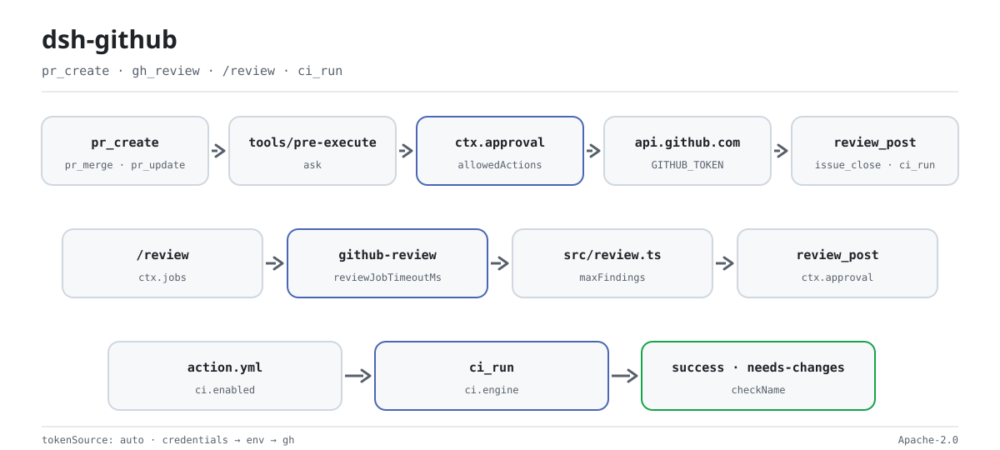

<div align="center">

<picture>
  <source media="(prefers-color-scheme: dark)" srcset="docs/assets/dsh-github-flow-dark.svg">
  
</picture>

# dsh-github

**Write to GitHub from the agent safely — every write is human-approved first, and the token never reaches a log.**

A host-side DeepSeek Harness plugin for PRs, reviews, issues, and CI: 15 tools, 4 command families, background review jobs, a CI composite action, and a status-check gate.

[Install](#three-step-setup) · [Configuration](#configuration) · [FAQ](#faq) · [简体中文](README.md) · [English](README.en.md) · [Español](README.es.md) · [Português](README.pt.md) · [हिन्दी](README.hi.md)

[](LICENSE)
[](#compatibility)
[](https://www.npmjs.com/package/@perrylink/dsh-github)
[](https://github.com/PerryLink/dsh-github/actions/workflows/ci.yml)
[](#compatibility)

[](https://github.com/PerryLink/dsh-github/stargazers)
[](https://www.npmjs.com/package/@perrylink/dsh-github)
[](https://dshfind.com/plugins/PerryLink/dsh-github?ref=badge)
[](https://securityscorecards.dev/viewer/?uri=github.com/PerryLink/dsh-github)
[](https://dsh.market/)
[](https://gitee.com/perrylink/dsh-github)

```sh
dsh plugin --profile <name> add @perrylink/dsh-github
```

</div>

<sub>Community plugin, not affiliated with DeepSeek. Canonical repository: <https://github.com/PerryLink/dsh-github> (Gitee is a mirror). It publishes to npm as `@perrylink/dsh-github`; the bare name `dsh-github` belongs to a different, unrelated project. Moved to [dsh-github-bot](https://github.com/PerryLink/dsh-github-bot): this repository stays as a pointer/backup, the old npm package `@perrylink/dsh-github` is deprecated — install `dsh-github-bot` for new work.</sub>

## What it is

`dsh-github` puts GitHub inside the agent's turn while keeping every write on a leash: tools such as `pr_create`, `pr_merge`, `review_post`, and `issue_close` only reach GitHub after `ctx.approval` returns an explicit yes. Read surfaces — PR metadata, capped diffs, files, search, and status checks — return without a prompt. `/review` runs a deterministic multi-file analyzer as a background job on `ctx.jobs`, while the CI side ships a composite action, a polling review bot, and a status-check gate. The token is resolved per operation from the credentials seam, the environment, or the `gh` CLI, sent only in the `Authorization` header, and never appears in logs, events, cards, command output, or errors.

## Three-step setup

1. **Install** (pick one channel):

   ```sh
   # git channel (latest main; equivalent to git+https://github.com/PerryLink/dsh-github.git)
   dsh plugin --profile web add github:PerryLink/dsh-github
   # npm channel (published releases)
   dsh plugin --profile web add @perrylink/dsh-github
   # tarball channel: pnpm pack in this repo, then
   dsh plugin --profile web add ./perrylink-dsh-github-<version>.tgz
   ```

   The `prepare` script builds with production dependencies only, so the git channel needs no extra setup.

2. **Minimal config** (defaults work; pin the token source if needed):

   ```yaml
   - insert:
       - id: dsh-github
         name: '@perrylink/dsh-github'
         config:
           tokenSource: auto
           autoCommit: false
   ```

   `tokenSource: auto` tries the Plugins page field → the credentials file → the environment → the `gh` CLI, in that order; the token itself never goes into this YAML.

3. **Verify it mounts**:

   ```sh
   dsh --profile web --dump-config | grep -A3 'id: dsh-github'
   ```

   A row with `id: dsh-github` means the plugin mounted; the first write goes through approval.

**Uninstall**: `dsh plugin --profile web remove @perrylink/dsh-github` (or remove the row from the profile patch).

<details>
<summary>Install from the DSH Desktop market</summary>

Every PerryLink plugin is listed in the built-in DSH Desktop market: **Market → Sources → Add source → paste** `https://perrylink-dsh-catalog.perrylink.workers.dev/catalog-source.json` **→ select**. Installation still requires the market's npm identity check and your confirmation.

</details>

### Examples

These are the plugin's real entry points; install once, then call one.

**Detailed example** — command `pr_create`, input:

```json
{
  "title": "feat: shiny",
  "body": "desc"
}
```

Output:

```text
created pull request #7: https://github.com/o/r/pull/7 (main ← feat/shiny)
```

*Observed from `plugins/dsh-github/test/tools.test.ts:69-74 (fixture + assertions); renderer at plugins/dsh-github/src/tools.ts:189`*

**Failure branch** — with no usable token at all, input:

```text
{"title":"x"} (credentials seam empty; GITHUB_TOKEN unset; gh not logged in)
```

Output:

```text
{
  "status": "error",
  "code": "no-token",
  "message": "no GitHub token found (source: credentials/env/gh)",
  "guidance": "Configure one of: 1) a dsh credential for this reference (recommended; $DSH_HOME/.credentials.yaml), 2) the same-named environment variable, or 3) `gh auth login` for the gh CLI. Set `tokenSource` in cordis.yml to pin one source."
}
```

*Observed from `plugins/dsh-github/src/credential.ts:96-104; plugins/dsh-github/test/tools.test.ts:88-93`*

**Brief examples**: `pr_merge` · `gh_review`

## Core capabilities

`dsh-github` fills the GitHub gap between `dsh` and tools like Claude Code and Codex: the agent can read, review, open, update, and merge pull requests, read repository metadata and files, comment on and close issues, and search — while a human approves every write and the token stays secret.

- **15 tools** — `pr_create`, `pr_merge`, `pr_update`, `gh_review`, `review_post`, `gh_issue`, `issue_open`, `issue_comment`, `issue_close`, `gh_search`, `gh_repo`, `gh_file`, `gh_repo_search`, `gh_checks`, all canonical JSON via `defineTool`, plus the one-shot `ci_run` when `ci.enabled` is on.
- **4 command families** — `/pr create`, `/review` (start/stop/post), `/issue open`, and `/ci` (scan/status/start/stop/run) under `ci.enabled`.
- **Full PR lifecycle** — create → review → update (title/body/state/base) → merge (merge/squash/rebase, optional head-branch delete).
- **Inline reviews** — `review_post` posts one summary comment or line-anchored review comments against the PR head commit.
- **Approval-gated writes** — every GitHub write goes through `ctx.approval` (default `ask`, fail-closed); approval reasons preview titles, body sizes, and comment overrides.
- **Token secrecy** — credentials seam → environment → `gh` CLI, resolved per operation, never in logs, events, renders, or errors.
- **Background review jobs** — `/review` runs on `ctx.jobs` with the host's own `job_list` / `job_output` / `job_kill` surface.
- **Resilience** — 429 retry with `Retry-After`/`x-ratelimit-reset` backoff; read tools are concurrency-safe; all calls honor cancellation.
- **CI surface** — the one-shot `ci_run` tool, a polling review bot, and a status-check gate (composite action `action.yml`).

### Tools & surfaces

| Surface | Kind | Notes |
|---|---|---|
| `pr_create` | tool | Create a pull request (write; approval-gated) |
| `pr_merge` | tool | Merge a PR (merge/squash/rebase, optional head-branch delete) |
| `pr_update` | tool | Update a PR (title/body/state/base) |
| `gh_review` | tool | Read a PR: metadata, capped diff, comments, CI, static findings |
| `review_post` | tool | Publish a review comment (summary or line-anchored inline) |
| `gh_issue` | tool | List / get / comment on issues (PRs marked `kind: "pr"`) |
| `issue_open` | tool | Create an issue |
| `issue_comment` | tool | Comment on an issue or PR |
| `issue_close` | tool | Close an issue (optional state reason) |
| `gh_search` | tool | Search issues and PRs (separate search quota) |
| `gh_repo` | tool | Read repository metadata |
| `gh_file` | tool | Read one file at a branch/tag/commit |
| `gh_repo_search` | tool | GraphQL repository search (separate search quota) |
| `gh_checks` | tool | GraphQL PR status checks (check runs + commit statuses) |
| `/pr create` | command | Read git state and queue a `pr_create` instruction |
| `/review` | command | Start / stop / post a background review job |
| `/issue open` | command | Queue an `issue_open` instruction |
| `/ci` | command | CI driver: scan / status / start / stop / run (`ci.enabled`) |
| `ci_run` | tool | One-shot CI review run by the composite action / CI driver |
| review bot | surface | Polling review bot with idempotent inline comments (`ci.*`) |
| status-check gate | surface | Publishes the `success` / `needs-changes` verdict per PR head commit (`action.yml`) |

### Architecture

- **Credential seam.** `tokenSource: auto` resolves per operation in the order credentials seam (the `GITHUB_TOKEN` reference) → environment variable → `gh` CLI token. The value is a local variable handed to the REST client; it never enters canonical values, renders, cards, command outputs, injected notices, job output, approval reasons, or error messages.
- **Approval gate.** All writes flow through model tools. A `tools/pre-execute` waterfall listener returns `ask` for the write tools, so the registry asks the human through `ctx.approval` (the host logs the `approval/asked` + `approval/decided` audit pair) and fails closed without an answerer. Commands never write directly: a write command gathers read-only context, then wakes the agent so the model runs the gated tool inside a turn.
- **Background review job.** `/review <pr>` starts a `github-review` job on `ctx.jobs`; the job fetches metadata (capturing the head-commit SHA for inline posting), the capped diff, CI checks, and existing comments, then runs the deterministic multi-file analyzer (`src/review.ts`). The job is owned by the calling agent's bare `SessionId` — `0.1.7-alpha.1` fences the registry on `SessionId` with no `Agent` union — so `dsh-tool-jobs` must be composed or `start` refuses. With `reviewMode: "model"`, the job hands the capped diff to a one-shot subagent through the host's `subagents` seam. Completion reaches the session through the host's `dsh-tool-jobs` consumer; the model reads it with `job_output` and publishes it with `review_post`.
- **CI composite action / review bot / status-check gate.** The repo ships a composite action (`action.yml`) that reviews PRs, fixes CI, and writes the report; a polling review bot posts idempotent inline comments; and a status-check gate publishes the verdict per PR head commit. The one-shot `ci_run` tool drives the headless run. Every write stays approval-gated.

## Configuration

All tunables are Schemastery `Config` fields (changeable from cordis.yml). An id-targeted override replaces the whole row — restate every key you need. `cordis.patch.yml` documents each key inline. In the GUI, the **Plugins page settings card** (Official group) reads `tokenRef` from the entry's own configuration form — the `0.1.7-alpha.1` host removed the `ctx.settingsScope` binding and the namespace-registration seam behind it, so the card no longer owns a settings namespace. The token itself is the entry's `githubToken` field: the card writes it there, and the host half resolves it ahead of the credentials file, the environment, and the gh CLI.

Most-used keys:

| Key | Default | Meaning |
|---|---|---|
| `tokenSource` | `auto` | `auto` (page field → credentials → env → gh) or one of `config` / `credentials` / `env` / `gh` |
| `tokenRef` | `GITHUB_TOKEN` | Credential-seam reference / environment-variable name |
| `githubToken` | — | Token saved from the Plugins page; plain text in the profile configuration, tried first while non-empty |
| `defaultOwnerRepo` | — | Fallback `owner/repo` when a call names none and git has no origin |
| `autoCommit` | `false` | Whether `/pr create` may instruct the model to commit + push first |
| `maxDiffChars` | `8000` | Character cap for PR diffs read into reviews |
| `reviewMode` | `static` | Review engine: `static` (deterministic analyzer) or `model` (one-shot subagent through the host's `subagents` seam; fails loud when the seam is absent) |
| `ci` | `{ enabled: false, … }` | CI integration section: polling review bot, status-check gate, and the one-shot `ci_run` tool (all `ci.*` keys live inside it) |

<details>
<summary>Full configuration table (23 keys)</summary>

| Key | Default | Meaning |
|---|---|---|
| `tokenSource` | `auto` | `auto` (page field → credentials → env → gh) or one of `config` / `credentials` / `env` / `gh` |
| `tokenRef` | `GITHUB_TOKEN` | Credential-seam reference / environment-variable name |
| `githubToken` | — | Token saved from the Plugins page; plain text in the profile configuration, tried first while non-empty |
| `defaultOwnerRepo` | — | Fallback `owner/repo` when a call names none and git has no origin |
| `autoCommit` | `false` | Whether `/pr create` may instruct the model to commit + push first |
| `maxDiffChars` | `8000` | Character cap for PR diffs read into reviews |
| `renderExcerptChars` | `2000` | Character cap for the diff excerpt rendered into tool output |
| `maxComments` | `20` | Cap for PR comments listed by `gh_review` |
| `reviewJobTimeoutMs` | `600000` | Deadline for one background review job (fails with `timeout`) |
| `maxReviewRecords` | `50` | Cap for in-memory review-job records; oldest settled records evict first |
| `maxFileChars` | `12000` | Character cap for file contents read by `gh_file` |
| `maxFindings` | `50` | Cap for analyzer findings per review |
| `maxLineLength` | `300` | Line length beyond which the analyzer flags a long-line finding |
| `reviewMode` | `static` | Review engine: `static` (deterministic analyzer) or `model` (one-shot subagent through the host's `subagents` seam; fails loud when the seam is absent) |
| `modelReviewProvider` | — | Subagent provider name for `reviewMode: "model"`; defaults to the first registered provider |
| `maxRetries` | `3` | 429 retry attempts per request |
| `retryBaseMs` | `500` | Retry backoff base (doubles per attempt) |
| `retryMaxWaitMs` | `60000` | Retry backoff ceiling |
| `requestTimeoutMs` | `30000` | Hard per-request timeout; aborts the fetch when exceeded |
| `apiBaseUrl` | `https://api.github.com` | GitHub REST base URL (GitHub Enterprise) |
| `allowedActions` | `['pr.create','pr.merge','pr.update','review.post','issue.create','issue.comment','issue.close','ci.run']` | Write-action whitelist; anything else is denied before approval |
| `workspaceDir` | process cwd | Working directory for read-only git inspection |
| `ci` | `{ enabled: false, … }` | CI integration section: polling review bot, status-check gate, and the one-shot `ci_run` tool (all `ci.*` keys live inside it) |

</details>

Example override in your profile patch:

```yaml
- insert:
    - id: dsh-github
      name: '@perrylink/dsh-github'
      config:
        tokenSource: auto
        tokenRef: GITHUB_TOKEN
        autoCommit: false
        reviewMode: static
        allowedActions: [pr.create, review.post, issue.create, issue.comment, issue.close, pr.merge, pr.update, ci.run]
```

## FAQ

<details>
<summary>Does the plugin store the token? Where does review data live?</summary>

The plugin never persists the token: it resolves one per operation in `tokenSource` order and puts it only in the `Authorization` header, never in logs, events, cards, command output, or errors. The one exception is a `githubToken` you save on the Plugins page yourself — it sits in the profile configuration as plain text (the same exposure as a credentials file); leave it empty when the configuration is shared and use a credential reference, the environment, or `gh auth login` instead. Review reports live in process memory keyed by job id; nothing durable is written to disk.

</details>

<details>
<summary>What happens with no token, or with no approval answerer? Silent failure?</summary>

No token produces a structured error with `code: "no-token"` and three configuration routes. A missing approval service or a missing answerer fails closed instead of passing the write through. Both are visible errors, not a fake success.

</details>

<details>
<summary>Does it fight other plugins over tool names, events, or slots?</summary>

No. Every tool is namespaced, it provides no service key, registers no client slot and no `webServer` prefix; the shared `tools/pre-execute` event is observed with `ctx.on()` broadcast semantics and every listener delegates through `next()`, so the chain is never short-circuited. The point-by-point argument is in "Interoperability with other DSH plugins".

</details>

<details>
<summary>Static review or model review?</summary>

The default `reviewMode: "static"` is deterministic, zero-token, and reproducible — right for most PRs. `reviewMode: "model"` hands the capped diff to a one-shot subagent, costs tokens, and requires the `subagents` seam plus a registered provider; otherwise it fails loudly at load.

</details>

<details>
<summary>What about GitHub rate limits or a flaky network?</summary>

429s are retried with backoff from `Retry-After` / `x-ratelimit-reset` (`maxRetries`, `retryBaseMs`, and `retryMaxWaitMs` are tunable), and every request has a hard `requestTimeoutMs`. The remaining quota is surfaced on every result, including failures.

</details>

## Security boundaries

- **Approval, not enforcement.** Writes only produce `ask`/deny decisions on the official seam; the sandbox and approval systems remain the enforcement authorities.
- **Fail closed.** Missing approval answerer degrades to the strictest decision — never to silent pass-through.
- **The token never leaves the process.** It is read per operation and sent only in the Authorization header; never logged, rendered, injected, or surfaced in errors.
- **No writes outside approval.** `/pr create` never commits or pushes by itself; with `autoCommit: true`, the model performs those writes through the bash tool's own approval gate. The review job performs no writes; only `review_post` publishes, after approval.
- **Untrusted content is escaped and marked.** `formatPostBody` backtick- and HTML-escapes diff-derived file names, and external GitHub content (files, bodies, comments, search results) is marked as external in renders.
- **Bounded work and rate limits.** 429s are retried with backoff; the remaining quota is surfaced on every result, including failures.

## Permissions & data

- **Permissions**: writes ride the official approval seam; nothing is re-implemented or bypassed. The plugin declares `network:outbound` and `filesystem:write` in its workshop manifest.
- **Data**: the review report lives in process memory keyed by job id; nothing durable is written to disk.
- **Session log**: the plugin adds no custom session event types; all model-visible content flows through host-logged surfaces (`tool/result`, `user/message`, `command/run`, `approval/asked`…). The notices commands queue carry the plugin's own merge-extensible source kind, `{ kind: 'dsh-github', form: 'notice', summary }` — the host has no catch-all `plugin` kind, and its session-format admission path refuses one outright.

## Known limitations

- **No custom session events** — deliberate (see Architecture); audit trails rely on the host's own event vocabulary.
- **Static analyzer by default** — deterministic rules (`src/review.ts`), zero tokens, reproducible. `reviewMode: "model"` costs tokens and requires the `subagents` seam and a registered provider.
- **Jobs and records are process-local** — the review report lives in plugin memory keyed by job id; the record map is capped by `maxReviewRecords` (oldest settled records evict first).
- **npm `latest` dist-tags are stale** — install through the profile closure `dsh-base` provides; never bare `npm i @deepseek-ai/dsh-tools`.

## Interoperability with other DSH plugins

Verified against **DSH `0.2.0-rc.2`** (the runtime this README ships for) and the high-star plugin set surveyed on 2026-10-05.

This plugin **does not interfere** with other plugins, including the widely installed high-star ones:

- **No tool-name collision.** Every tool is namespaced; no bare name owned by a shipped tool or another plugin is registered.
- **No service-key collision.** It provides no service key at all, so it cannot collide on one.
- **No slot collision.** It registers no client slot key, so it cannot contend for a `shadows-shipped-ui` seat.
- **No HTTP route collision.** It registers no `webServer` prefix.
- **No patch-layer collision.** The bundle patch only `insert`s its own row; it never overrides a built-in row's `config`.
- **No global mutation.** It does not patch prototypes, rewrite `process.env`, or replace the global fetch dispatcher.

**Shared event listeners are non-interfering by construction.** It observes the ordering-sensitive event `tools/pre-execute` with `ctx.on()` — Cordis's broadcast registration, where every listener runs and none can starve another. **Every listener here delegates through `next()`**, so the chain is never short-circuited, and a mutation is applied to the value `next()` produced rather than returned in its place:

- `tools/pre-execute` — also used by `cc-safety-net` (1576★).

Static evidence: `dsh-plugin-doctor` K10–K13 report `pass` for every check on this repository.

## Compatibility

| Surface | Status |
|---|---|
| Harness | DeepSeek Harness `dsh-v0.2.1-rc.2` (verified 2026-10-18): `engines.dsh >=0.2.1-0 <0.3.0`; the P0 compatibility paths have regression tests. |
| Node | `^22.19.0 \|\| >=24.0.0` |
| Platforms | All (host plugin; outbound network to GitHub) |
| Model | Any (static review is deterministic; `reviewMode: "model"` is optional) |

## Ecosystem & quality

- [Gitee mirror](https://gitee.com/perrylink/dsh-github) (sync mirror; GitHub is canonical)
- [dshfind plugin page](https://dshfind.com/plugins/PerryLink/dsh-github) (installs and ranking)
- [OpenSSF Scorecard report](https://securityscorecards.dev/viewer/?uri=github.com/PerryLink/dsh-github) (driven by [.github/workflows/scorecard.yml](.github/workflows/scorecard.yml))
- [dsh-plugin-doctor verification report](https://github.com/PerryLink/dsh-plugin-doctor#verified-徽章) (K10–K13 all `pass`)
- [DSH Market](https://dsh.market/) (listed)
- **1024 store channel**: `npm i -g dsh1024` once, then `dsh1024 plugin --profile web add @perrylink/dsh-github` (counts toward the [deepseek1024.com](https://deepseek1024.com) install ranking)
- [Ecosystem knowledge base](https://perrylink.github.io/dsh-plugin-guide/) — measured data, not marketing: plugin development guide · plugin-selection data · maintenance criteria

## Development

```sh
pnpm install             # node ^22.19 || >=24
pnpm run build           # tsc --noEmitOnError → lib/ (plus fix-dts and the client bundle)
pnpm run prepare         # self-contained git-install build (scripts/prepare.mjs)
pnpm run prepublishOnly  # build + test before publishing
pnpm test                # vitest run
pnpm run typecheck       # tsc --noEmit
pnpm run typecheck:ci    # published-line typecheck
pnpm run check:readmes   # cross-checks tools and config keys across the 5 READMEs
```

`lib/` is the shipped artifact committed to the repo; `pnpm run build` regenerates it. The README images are generated programmatically by [`scripts/gen-readme-assets.py`](scripts/gen-readme-assets.py) (Python + Pillow) and are safe to re-run; they write `docs/assets/dsh-github-flow-{light,dark}.svg`.

Topics: `dsh` · `dsh-plugin` · `deepseek-harness` · `github` · `pull-request` · `code-review` · `issue-tracker`

### Repository layout

```text
src/index.ts          plugin entry (name/inject/apply, applyWithDeps for tests)
src/config.ts         Schemastery Config
src/types.ts          local structural views of host services + Context merging
src/credential.ts     token resolution (seam → env → gh), per operation
src/github.ts         REST client: 429 retry, rate limits, diff media type
src/git.ts            read-only git inspection + origin parsing for any API host
src/review.ts         deterministic diff analyzer + sanitized comment drafting
src/jobs.ts           github-review background job producer (metadata + diff + CI + comments)
src/approval-gate.ts  tools/pre-execute ask/deny gate with write previews
src/tools.ts          the fourteen model-facing tools
src/ci/               review pipeline, polling bot, one-shot ci_run
src/commands.ts       /pr, /review, /issue
src/client.ts         browser half: the Plugins settings card
src/present.ts        pure UI-card presenters
test/                 vitest suite + mock host scaffolding + opt-in e2e smoke
cordis.patch.yml      bundle patch (one insert row)
scripts/prepare.mjs   self-contained git-install build
```

## Family & thanks

This project is part of the DeepSeek Harness plugin family from [PerryLink](https://github.com/PerryLink) (all Apache-2.0). If it is useful, **a star helps the next person find it** — nothing is gated behind it.

- [@JosephTian876](https://github.com/JosephTian876) — the unbundled `lib/client.js` report (#11).
- [@womeimingzi11](https://github.com/womeimingzi11) — the browser-half module-loader registration report (#14); the factory-wrapped bundle shipped in later releases.
- [@PerryLink](https://github.com/PerryLink) — creator and maintainer: the GitHub tool surface, approval gate, background review jobs, CI composite action, review bot, status-check gate, and the five-language docs.
- [@AraragiEro](https://github.com/AraragiEro) — the GitHub token settings card in the Plugins settings page (#6).
- [@alexchenzl](https://github.com/alexchenzl) — invited the plugin onto the DSH Directory (#5).

<details>
<summary>Expand all plugins</summary>

| Plugin | Status |
|---|---|
| **[dsh-aqua-input-check](https://github.com/PerryLink/dsh-aqua-input-check)** |  |
| **[dsh-archive-check](https://github.com/PerryLink/dsh-archive-check)** |  |
| **[dsh-auto-review](https://github.com/PerryLink/dsh-auto-review)** |  |
| **[dsh-autotier](https://github.com/PerryLink/dsh-autotier)** | 🧊 FROZEN — see the repo README |
| **[dsh-bid-ca-precheck](https://github.com/PerryLink/dsh-bid-ca-precheck)** |  |
| **[dsh-bid-qual-check](https://github.com/PerryLink/dsh-bid-qual-check)** |  |
| **[dsh-cert-mcp](https://github.com/PerryLink/dsh-cert-mcp)** | 🧊 FROZEN — see the repo README |
| **[dsh-checkpoint-rewind](https://github.com/PerryLink/dsh-checkpoint-rewind)** |  |
| **[dsh-click](https://github.com/PerryLink/dsh-click)** |  |
| **[dsh-composer-history](https://github.com/PerryLink/dsh-composer-history)** |  |
| **[dsh-contract-stance](https://github.com/PerryLink/dsh-contract-stance)** |  |
| **[dsh-customs-doc-check](https://github.com/PerryLink/dsh-customs-doc-check)** |  |
| **[dsh-data-quality](https://github.com/PerryLink/dsh-data-quality)** | 🧊 FROZEN — see the repo README |
| **[dsh-demurrage-ledger](https://github.com/PerryLink/dsh-demurrage-ledger)** |  |
| **[dsh-doublecheck](https://github.com/PerryLink/dsh-doublecheck)** |  |
| **[dsh-drill-script-check](https://github.com/PerryLink/dsh-drill-script-check)** |  |
| **[dsh-eia-guide-check](https://github.com/PerryLink/dsh-eia-guide-check)** |  |
| **[dsh-emergency-plan](https://github.com/PerryLink/dsh-emergency-plan)** |  |
| **[dsh-essay-rubric-check](https://github.com/PerryLink/dsh-essay-rubric-check)** |  |
| **[dsh-evidence-check](https://github.com/PerryLink/dsh-evidence-check)** |  |
| **[dsh-export-ctl-check](https://github.com/PerryLink/dsh-export-ctl-check)** |  |
| **[dsh-fast](https://github.com/PerryLink/dsh-fast)** |  |
| **[dsh-fmea-table-check](https://github.com/PerryLink/dsh-fmea-table-check)** |  |
| **[dsh-forecast-penalty](https://github.com/PerryLink/dsh-forecast-penalty)** |  |
| **[dsh-fund-research](https://github.com/PerryLink/dsh-fund-research)** |  |
| **[dsh-github](https://github.com/PerryLink/dsh-github)** |  |
| **[dsh-gongwen-flow-check](https://github.com/PerryLink/dsh-gongwen-flow-check)** |  |
| **[dsh-gongwen-word-check](https://github.com/PerryLink/dsh-gongwen-word-check)** |  |
| **[dsh-guard-plan-qc](https://github.com/PerryLink/dsh-guard-plan-qc)** |  |
| **[dsh-hazchem-check](https://github.com/PerryLink/dsh-hazchem-check)** |  |
| **[dsh-hazplan-check](https://github.com/PerryLink/dsh-hazplan-check)** |  |
| **[dsh-hidden-risk-map](https://github.com/PerryLink/dsh-hidden-risk-map)** |  |
| **[dsh-hs-classify](https://github.com/PerryLink/dsh-hs-classify)** |  |
| **[dsh-icd-rule-check](https://github.com/PerryLink/dsh-icd-rule-check)** |  |
| **[dsh-industry-research](https://github.com/PerryLink/dsh-industry-research)** |  |
| **[dsh-lawcite-adapter](https://github.com/PerryLink/dsh-lawcite-adapter)** |  |
| **[dsh-laya](https://github.com/PerryLink/dsh-laya)** |  |
| **[dsh-lc-doc-check](https://github.com/PerryLink/dsh-lc-doc-check)** |  |
| **[dsh-learning-gap-check](https://github.com/PerryLink/dsh-learning-gap-check)** |  |
| **[dsh-library](https://github.com/PerryLink/dsh-library)** |  |
| **[dsh-local-ai](https://github.com/PerryLink/dsh-local-ai)** |  |
| **[dsh-lsp-actions](https://github.com/PerryLink/dsh-lsp-actions)** |  |
| **[dsh-mask](https://github.com/PerryLink/dsh-mask)** |  |
| **[dsh-mcp-panel](https://github.com/PerryLink/dsh-mcp-panel)** |  |
| **[dsh-medrec-qc](https://github.com/PerryLink/dsh-medrec-qc)** |  |
| **[dsh-memento](https://github.com/PerryLink/dsh-memento)** | 🧊 FROZEN — see the repo README |
| **[dsh-nsfc-form-check](https://github.com/PerryLink/dsh-nsfc-form-check)** |  |
| **[dsh-nurse-record-check](https://github.com/PerryLink/dsh-nurse-record-check)** |  |
| **[dsh-observe](https://github.com/PerryLink/dsh-observe)** |  |
| **[dsh-origin-rvc-check](https://github.com/PerryLink/dsh-origin-rvc-check)** |  |
| **[dsh-ota-review-check](https://github.com/PerryLink/dsh-ota-review-check)** |  |
| **[dsh-output-styles](https://github.com/PerryLink/dsh-output-styles)** |  |
| **[dsh-paper-doc-adapter](https://github.com/PerryLink/dsh-paper-doc-adapter)** |  |
| **[dsh-permission-rules](https://github.com/PerryLink/dsh-permission-rules)** |  |
| **[dsh-permit-report-check](https://github.com/PerryLink/dsh-permit-report-check)** |  |
| **[dsh-pipeline-check](https://github.com/PerryLink/dsh-pipeline-check)** |  |
| **[dsh-pleading-draft](https://github.com/PerryLink/dsh-pleading-draft)** |  |
| **[dsh-plugin-doctor](https://github.com/PerryLink/dsh-plugin-doctor)** | 🚫 RETIRED (repo archived) |
| **[dsh-plugin-guide](https://github.com/PerryLink/dsh-plugin-guide)** |  |
| **[dsh-plugin-kit](https://github.com/PerryLink/dsh-plugin-kit)** | 🚫 RETIRED (repo archived) |
| **[dsh-plugin-upgrade](https://github.com/PerryLink/dsh-plugin-upgrade)** | 🚫 RETIRED (repo archived) |
| **[dsh-policy-brief-draft](https://github.com/PerryLink/dsh-policy-brief-draft)** |  |
| **[dsh-power-loss-split](https://github.com/PerryLink/dsh-power-loss-split)** |  |
| **[dsh-power-ticket-check](https://github.com/PerryLink/dsh-power-ticket-check)** |  |
| **[dsh-ppap-check](https://github.com/PerryLink/dsh-ppap-check)** |  |
| **[dsh-protest-deadline](https://github.com/PerryLink/dsh-protest-deadline)** |  |
| **[dsh-railway-window](https://github.com/PerryLink/dsh-railway-window)** |  |
| **[dsh-repair-order-qc](https://github.com/PerryLink/dsh-repair-order-qc)** |  |
| **[dsh-research-report](https://github.com/PerryLink/dsh-research-report)** |  |
| **[dsh-review-reply-check](https://github.com/PerryLink/dsh-review-reply-check)** |  |
| **[dsh-rulefile-check](https://github.com/PerryLink/dsh-rulefile-check)** |  |
| **[dsh-safety-brief-check](https://github.com/PerryLink/dsh-safety-brief-check)** |  |
| **[dsh-score](https://github.com/PerryLink/dsh-score)** | 🧊 FROZEN — see the repo README |
| **[dsh-session-sync](https://github.com/PerryLink/dsh-session-sync)** |  |
| **[dsh-site-log-check](https://github.com/PerryLink/dsh-site-log-check)** |  |
| **[dsh-skill-pack-security](https://github.com/PerryLink/dsh-skill-pack-security)** |  |
| **[dsh-soe-decision-check](https://github.com/PerryLink/dsh-soe-decision-check)** |  |
| **[dsh-soilwater-check](https://github.com/PerryLink/dsh-soilwater-check)** |  |
| **[dsh-sop-sync-check](https://github.com/PerryLink/dsh-sop-sync-check)** |  |
| **[dsh-spc-gbt-adapter](https://github.com/PerryLink/dsh-spc-gbt-adapter)** |  |
| **[dsh-talk](https://github.com/PerryLink/dsh-talk)** |  |
| **[dsh-tender-extract](https://github.com/PerryLink/dsh-tender-extract)** |  |
| **[dsh-tender-matrix](https://github.com/PerryLink/dsh-tender-matrix)** |  |
| **[dsh-test-drive](https://github.com/PerryLink/dsh-test-drive)** |  |
| **[dsh-ticktick](https://github.com/PerryLink/dsh-ticktick)** | 🚫 RETIRED (repo archived) |
| **[dsh-translate](https://github.com/PerryLink/dsh-translate)** |  |
| **[dsh-warranty-calc](https://github.com/PerryLink/dsh-warranty-calc)** |  |
| **[dsh-budget](https://github.com/PerryLink/dsh-budget)** | 🧊 FROZEN — see the repo README |
| **[dsh-claude-move](https://github.com/PerryLink/dsh-claude-move)** | 🧊 FROZEN — see the repo README |
| **[dsh-defend](https://github.com/PerryLink/dsh-defend)** | 🧊 FROZEN — see the repo README |
| **[dsh-draw](https://github.com/PerryLink/dsh-draw)** | 🧊 FROZEN — see the repo README |
| **[dsh-reach](https://github.com/PerryLink/dsh-reach)** | 🧊 FROZEN — see the repo README |
| **[dsh-background-agents](https://github.com/PerryLink/dsh-background-agents)** | 🚫 RETIRED (repo archived) |
| **[dsh-session-pin](https://github.com/PerryLink/dsh-session-pin)** | 🚫 RETIRED (repo archived) |
| **[dsh-team-rooms](https://github.com/PerryLink/dsh-team-rooms)** | 🚫 RETIRED (repo archived) |

</details>

## License

[LICENSE](LICENSE) (Apache License 2.0) © 2026 dsh-github contributors

<p align="center"><sub>Apache-2.0 · Community plugin, not affiliated with DeepSeek.</sub></p>
