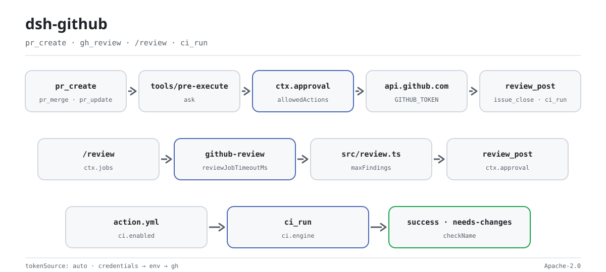

<div align="center">

<picture>
  <source media="(prefers-color-scheme: dark)" srcset="docs/assets/dsh-github-flow-dark.svg">
  
</picture>

# dsh-github

**在 agent 里安全地写 GitHub——每个写操作先经人类审批，token 永不落日志。**

把 PR、审查、issue 与 CI 接入 DeepSeek Harness 的主机端插件：15 个工具、4 族命令、后台审查 job、CI 复合动作与状态检查门禁。

[安装](#三步上手) · [配置](#配置) · [FAQ](#faq) · [简体中文](README.md) · [English](README.en.md) · [Español](README.es.md) · [Português](README.pt.md) · [हिन्दी](README.hi.md)

[](LICENSE)
[](#兼容性)
[](https://www.npmjs.com/package/@perrylink/dsh-github)
[](https://github.com/PerryLink/dsh-github/actions/workflows/ci.yml)
[](#兼容性)

[](https://github.com/PerryLink/dsh-github/stargazers)
[](https://www.npmjs.com/package/@perrylink/dsh-github)
[](https://dshfind.com/plugins/PerryLink/dsh-github?ref=badge)
[](https://securityscorecards.dev/viewer/?uri=github.com/PerryLink/dsh-github)
[](https://dsh.market/)
[](https://gitee.com/perrylink/dsh-github)

```sh
dsh plugin --profile <name> add @perrylink/dsh-github
```

</div>

<sub>社区插件，与 DeepSeek 官方无关；唯一仓库：<https://github.com/PerryLink/dsh-github>（Gitee 为镜像）。npm 发布名是 `@perrylink/dsh-github`，裸名 `dsh-github` 属于另一个无关项目。项目已迁移到 [dsh-github-bot](https://github.com/PerryLink/dsh-github-bot)：本仓库保留为索引/备份，旧 npm 包 `@perrylink/dsh-github` 已弃用，新工作请安装 `dsh-github-bot`。</sub>

## 它是什么

`dsh-github` 把 GitHub 的 PR、审查、issue 与 CI 接进 agent 的回合，同时给每个写操作套上审批笼子：`pr_create`、`pr_merge`、`review_post`、`issue_close` 这类工具只有在 `ctx.approval` 得到明确同意后才会落到 GitHub。读侧（PR 元数据、截断 diff、文件、搜索、状态检查）不设审批，直接返回。后台 `/review` 在 `ctx.jobs` 上跑确定性多文件分析器，CI 侧另有一套复合动作、轮询审查机器人与状态检查门禁。token 逐操作从 credentials seam、环境变量或 `gh` CLI 解析，只进 `Authorization` 头，日志、事件、卡片、命令输出与错误消息里都看不到它。

## 三步上手

1. **安装**（三选一）：

   ```sh
   # git 通道（最新 main；等价于 git+https://github.com/PerryLink/dsh-github.git）
   dsh plugin --profile web add github:PerryLink/dsh-github
   # npm 通道（已发布版本）
   dsh plugin --profile web add @perrylink/dsh-github
   # tarball 通道：本仓库 pnpm pack 后
   dsh plugin --profile web add ./perrylink-dsh-github-<version>.tgz
   ```

   `prepare` 脚本只带生产依赖构建，git 通道无需额外准备。

2. **最小配置**（默认即可用；token 按需指定来源）：

   ```yaml
   - insert:
       - id: dsh-github
         name: '@perrylink/dsh-github'
         config:
           tokenSource: auto
           autoCommit: false
   ```

   `tokenSource: auto` 会依次尝试 Plugins 页字段 → credentials 文件 → 环境变量 → `gh` CLI，token 本身不写进这份 YAML。

3. **验证已生效**：

   ```sh
   dsh --profile web --dump-config | grep -A3 'id: dsh-github'
   ```

   看到 `id: dsh-github` 这一行即挂载成功；第一次写操作会走审批。

**卸载**：`dsh plugin --profile web remove @perrylink/dsh-github`（或从 profile patch 里删掉该行）。

<details>
<summary>从 DSH Desktop 市场安装</summary>

所有 PerryLink 插件均可在 DSH Desktop 内置市场中浏览：**市场 → 来源 → 添加来源 → 粘贴** `https://perrylink-dsh-catalog.perrylink.workers.dev/catalog-source.json` **→ 选中**。安装仍需通过市场的 npm 身份校验与你的确认。

</details>

### 示例

以下为插件真实入口；安装后调用一个即可。

**详细示例** — 命令 `pr_create`，输入：

```json
{
  "title": "feat: shiny",
  "body": "desc"
}
```

输出：

```text
created pull request #7: https://github.com/o/r/pull/7 (main ← feat/shiny)
```

*Observed from `plugins/dsh-github/test/tools.test.ts:69-74 (fixture + assertions); renderer at plugins/dsh-github/src/tools.ts:189`*

**失败分支** — 没有任何可用 token 时，输入：

```text
{"title":"x"} (credentials seam empty; GITHUB_TOKEN unset; gh not logged in)
```

输出：

```text
{
  "status": "error",
  "code": "no-token",
  "message": "no GitHub token found (source: credentials/env/gh)",
  "guidance": "Configure one of: 1) a dsh credential for this reference (recommended; $DSH_HOME/.credentials.yaml), 2) the same-named environment variable, or 3) `gh auth login` for the gh CLI. Set `tokenSource` in cordis.yml to pin one source."
}
```

*Observed from `plugins/dsh-github/src/credential.ts:96-104; plugins/dsh-github/test/tools.test.ts:88-93`*

**简短示例**：`pr_merge` · `gh_review`

## 核心能力

`dsh-github` 补上了 `dsh` 与 Claude Code、Codex 之类工具之间的 GitHub 缺口：agent 能读、审、开、改、合 PR，读仓库元数据与文件，评论与关闭 issue，以及搜索——每个写操作都有人类审批，token 全程保密。

- **15 个工具** —— `pr_create`、`pr_merge`、`pr_update`、`gh_review`、`review_post`、`gh_issue`、`issue_open`、`issue_comment`、`issue_close`、`gh_search`、`gh_repo`、`gh_file`、`gh_repo_search`、`gh_checks`，全部经 `defineTool` 返回规范 JSON；`ci.enabled` 打开时再加一次性 `ci_run`。
- **4 族命令** —— `/pr create`、`/review`（start / stop / post）、`/issue open`，以及 `ci.enabled` 下的 `/ci`（scan / status / start / stop / run）。
- **完整 PR 生命周期** —— 创建 → 审查 → 更新（标题 / 正文 / 状态 / 目标分支）→ 合并（merge / squash / rebase，可选合并后删源分支）。
- **行级审查** —— `review_post` 可发布单条汇总评论，或按行锚定 PR head commit 的行级审查评论。
- **写操作审批** —— 每个 GitHub 写操作都经 `ctx.approval`（默认 `ask`，fail-closed）；审批理由预览标题、正文长度与评论覆盖内容。
- **token 保密** —— credentials seam → 环境变量 → `gh` CLI，逐操作解析，绝不进日志、事件、渲染或错误。
- **后台审查 job** —— `/review` 跑在 `ctx.jobs` 上，复用宿主自带 `job_list` / `job_output` / `job_kill` 工具面。
- **韧性** —— 按 `Retry-After` / `x-ratelimit-reset` 退避重试 429；读工具并发安全；所有调用尊重取消信号。
- **CI 界面** —— 一次性 `ci_run` 工具、轮询式审查机器人与状态检查门禁（复合动作 `action.yml`）。

### 工具与界面

| 界面 | 类型 | 说明 |
|---|---|---|
| `pr_create` | 工具 | 创建 pull request（写；审批门控） |
| `pr_merge` | 工具 | 合并 PR（merge / squash / rebase，可选删源分支） |
| `pr_update` | 工具 | 更新 PR（标题 / 正文 / 状态 / 目标分支） |
| `gh_review` | 工具 | 读取 PR：元数据、截断 diff、评论、CI、静态发现 |
| `review_post` | 工具 | 发布审查评论（汇总或行级锚定） |
| `gh_issue` | 工具 | 列出 / 获取 / 评论 issue（PR 标记为 `kind: "pr"`） |
| `issue_open` | 工具 | 创建 issue |
| `issue_comment` | 工具 | 评论 issue 或 PR |
| `issue_close` | 工具 | 关闭 issue（可选关闭原因） |
| `gh_search` | 工具 | 搜索 issue 与 PR（独立搜索配额） |
| `gh_repo` | 工具 | 读取仓库元数据 |
| `gh_file` | 工具 | 按分支 / tag / commit 读取单个文件 |
| `gh_repo_search` | 工具 | GraphQL 仓库搜索（独立搜索配额） |
| `gh_checks` | 工具 | GraphQL PR 状态检查（check runs + commit statuses） |
| `/pr create` | 命令 | 读取 git 状态并排队一条 `pr_create` 指令 |
| `/review` | 命令 | 启动 / 停止 / 发布后台审查 job |
| `/issue open` | 命令 | 排队一条 `issue_open` 指令 |
| `/ci` | 命令 | CI 驱动：scan / status / start / stop / run（`ci.enabled`） |
| `ci_run` | 工具 | 由复合动作 / CI 驱动执行的一次性 CI 审查 |
| 审查机器人 | 界面 | 带幂等行内评论的轮询式审查机器人（`ci.*`） |
| 状态检查门禁 | 界面 | 按 PR head commit 发布 `success` / `needs-changes` 结论（`action.yml`） |

### 架构

- **凭证接缝。** `tokenSource: auto` 每次操作按 credentials seam（`GITHUB_TOKEN` 引用）→ 环境变量 → `gh` CLI token 的顺序解析。该值只是交给 REST 客户端的局部变量，绝不进入规范值、渲染、卡片、命令输出、注入通知、job 输出、审批理由或错误消息。
- **审批门。** 所有写操作都经模型工具。`tools/pre-execute` waterfall 监听器对写工具返回 `ask`，注册表即通过 `ctx.approval` 询问人类（宿主落 `approval/asked` + `approval/decided` 审计对），无应答者时 fail-closed。命令从不直接写：写命令先收集只读上下文，再唤醒 agent，让模型在 turn 内调用受审批门保护的工具。
- **后台审查 job。** `/review <pr>` 在 `ctx.jobs` 上启动 `github-review` job；job 抓取元数据（记录 head-commit SHA 供行级发布）、截断 diff、CI 检查与既有评论，然后运行确定性多文件分析器（`src/review.ts`）。该 job 由调用 agent 的裸 `SessionId` 归属——`0.1.7-alpha.1` 的注册表以 `SessionId` 做访问围栏、不再接受 `Agent` 联合——因此必须组合 `dsh-tool-jobs`，否则 `start` 会直接拒绝。`reviewMode: "model"` 时改为把截断 diff 交给宿主 `subagents` 接缝的一次性 subagent。完成通知经宿主的 `dsh-tool-jobs` 消费者送回会话；模型用 `job_output` 读取、用 `review_post` 发布。
- **CI 复合动作 / 审查机器人 / 状态检查门禁。** 本仓库随附复合动作（`action.yml`），负责审查 PR、修复 CI 并产出报告；轮询式审查机器人发布幂等行内评论；状态检查门禁按 PR head commit 发布结论。一次性 `ci_run` 工具驱动 headless 运行。每个写操作都保持审批门控。

## 配置

所有可调项都是 Schemastery `Config` 字段（可从 cordis.yml 修改）。以 id 定位的覆盖会替换整行——需要重新声明你所需的每个键。`cordis.patch.yml` 逐键内联说明。在图形界面中，**Plugins 页设置卡**（Official 组）从该条目自己的配置表单读取 `tokenRef`：`0.1.7-alpha.1` 宿主已删除 `ctx.settingsScope` 绑定及其背后的命名空间注册缝，卡片因此不再拥有设置命名空间。令牌本身就是该条目的 `githubToken` 字段：卡片写到这里，宿主半部按「页面字段 → 凭证文件 → 环境变量 → gh」的顺序解析。

最常用键：

| 键 | 默认值 | 含义 |
|---|---|---|
| `tokenSource` | `auto` | `auto`（页面字段 → credentials → env → gh）或指定 `config` / `credentials` / `env` / `gh` |
| `tokenRef` | `GITHUB_TOKEN` | credentials seam 引用名 / 环境变量名 |
| `githubToken` | — | 从插件页保存的令牌；以明文存于 profile 配置，非空时优先使用 |
| `defaultOwnerRepo` | — | 调用未指定且 git 无 origin 时的兜底 `owner/repo` |
| `autoCommit` | `false` | `/pr create` 是否允许指示模型先 commit + push |
| `maxDiffChars` | `8000` | 审查读取 PR diff 的字符数上限 |
| `reviewMode` | `static` | 评审引擎：`static`（确定性分析器）或 `model`（经宿主 `subagents` 接缝的一次性 subagent；接缝缺失时响亮失败） |
| `ci` | `{ enabled: false, … }` | CI 集成段：轮询式审查机器人、状态检查门禁与一次性 `ci_run` 工具（其下为全部 `ci.*` 子键） |

<details>
<summary>完整配置表（23 个键）</summary>

| 键 | 默认值 | 含义 |
|---|---|---|
| `tokenSource` | `auto` | `auto`（页面字段 → credentials → env → gh）或指定 `config` / `credentials` / `env` / `gh` |
| `tokenRef` | `GITHUB_TOKEN` | credentials seam 引用名 / 环境变量名 |
| `githubToken` | — | 从插件页保存的令牌；以明文存于 profile 配置，非空时优先使用 |
| `defaultOwnerRepo` | — | 调用未指定且 git 无 origin 时的兜底 `owner/repo` |
| `autoCommit` | `false` | `/pr create` 是否允许指示模型先 commit + push |
| `maxDiffChars` | `8000` | 审查读取 PR diff 的字符数上限 |
| `renderExcerptChars` | `2000` | 渲染进工具输出的 diff 摘要字符数上限 |
| `maxComments` | `20` | `gh_review` 列出 PR 评论的上限 |
| `reviewJobTimeoutMs` | `600000` | 单个后台审查 job 的截止时间（超时以 `timeout` 失败） |
| `maxReviewRecords` | `50` | 内存审查 job 记录上限；最旧的已终态记录先淘汰 |
| `maxFileChars` | `12000` | `gh_file` 读取文件内容的字符数上限 |
| `maxFindings` | `50` | 每次审查分析器发现数上限 |
| `maxLineLength` | `300` | 行长度超过该值时分析器报超长行发现 |
| `reviewMode` | `static` | 评审引擎：`static`（确定性分析器）或 `model`（经宿主 `subagents` 接缝的一次性 subagent；接缝缺失时响亮失败） |
| `modelReviewProvider` | — | `reviewMode: "model"` 使用的 subagent provider 名；缺省用第一个注册的 provider |
| `maxRetries` | `3` | 单请求的 429 重试次数 |
| `retryBaseMs` | `500` | 重试退避基数（逐次翻倍） |
| `retryMaxWaitMs` | `60000` | 重试退避上限 |
| `requestTimeoutMs` | `30000` | 单次请求硬超时；超时即中止 fetch |
| `apiBaseUrl` | `https://api.github.com` | GitHub REST 基地址（GitHub Enterprise） |
| `allowedActions` | `pr.create` · `pr.merge` · `pr.update` · `review.post` · `issue.create` · `issue.comment` · `issue.close` · `ci.run` | 写动作白名单；名单外直接拒绝 |
| `workspaceDir` | 进程 cwd | 只读 git 检查的工作目录 |
| `ci` | `{ enabled: false, … }` | CI 集成段：轮询式审查机器人、状态检查门禁与一次性 `ci_run` 工具（其下为全部 `ci.*` 子键） |

</details>

profile patch 覆盖示例：

```yaml
- insert:
    - id: dsh-github
      name: '@perrylink/dsh-github'
      config:
        tokenSource: auto
        tokenRef: GITHUB_TOKEN
        autoCommit: false
        reviewMode: static
        allowedActions: [pr.create, review.post, issue.create, issue.comment, issue.close, pr.merge, pr.update, ci.run]
```

## FAQ

<details>
<summary>token 会不会被插件存下来？审查数据存在哪？</summary>

插件本身不落盘 token：每次操作按 `tokenSource` 的顺序现取，只放进 `Authorization` 头，绝不写日志、事件、卡片、命令输出或错误。唯一例外是你主动在 Plugins 页设置卡里保存的 `githubToken`——它以明文存在 profile 配置里（与 credentials 文件同级的暴露面）；配置会共享给别人时请留空，改用凭证引用、环境变量或 `gh auth login`。审查报告按 job id 只存进程内存，不向磁盘写任何持久数据。

</details>

<details>
<summary>没配 token，或宿主没有审批应答者，会静默失败吗？</summary>

不会。没 token 时工具返回结构化错误，`code` 为 `no-token`，并附上三条配置指引；审批服务缺失或没有人应答时，写操作 fail-closed，绝不静默放行。两者都是可见错误，不是“看起来成功”。

</details>

<details>
<summary>会和其他插件抢工具名、事件或 slot 吗？</summary>

不会。工具全部带命名空间，不提供 service key、不注册客户端 slot、不注册 `webServer` 前缀；共享的 `tools/pre-execute` 用 `ctx.on()` 广播监听，每个监听器都经 `next()` 委托，链条不会被短路。逐条论证见「与其他 DSH 插件的互操作性」。

</details>

<details>
<summary>静态审查和模型审查怎么选？</summary>

默认 `reviewMode: "static"`：确定性规则、零 token、可复现，适合绝大多数 PR。`reviewMode: "model"` 把截断 diff 交给一次性 subagent，会消耗 token，且要求宿主提供 `subagents` 接缝和已注册 provider，否则加载期响亮失败。

</details>

<details>
<summary>GitHub 限流或网络抖动会怎样？</summary>

429 按 `Retry-After` / `x-ratelimit-reset` 退避重试（`maxRetries`、`retryBaseMs`、`retryMaxWaitMs` 可调），每个请求还有 `requestTimeoutMs` 硬超时；剩余配额会随每次结果返回，失败时也可见。

</details>

## 安全边界

- **审批，而非强制执行。** 写操作只在官方接缝上产生 `ask` / deny 决策；沙箱与审批系统仍是执行权威。
- **Fail closed。** 缺少审批应答者时退化为最严格决策——绝不静默放行。
- **token 不离开进程。** 逐操作读取，只写入 `Authorization` 头；从不落日志、渲染、注入或出现在错误中。
- **审批之外无写操作。** `/pr create` 自己从不 commit / push；`autoCommit: true` 时模型经 bash 工具自身的审批门执行这些写操作。审查 job 零写操作；只有 `review_post` 在审批后发布。
- **不可信内容被转义与标记。** `formatPostBody` 对 diff 派生的文件名做反引号与 HTML 转义，外部 GitHub 内容（文件、正文、评论、搜索结果）在渲染中被标记为外部内容。
- **有界工作与配额。** 429 带退避重试；剩余配额在包括失败在内的每个结果上对模型可见。

## 权限与数据

- **权限**：写操作走官方审批接缝；没有任何东西被重实现或绕过。插件在其 workshop manifest 中声明 `network:outbound` 与 `filesystem:write`。
- **数据**：审查报告按 job id 存于进程内存；不向磁盘写任何持久数据。
- **会话日志**：插件不新增任何自定义会话事件类型；所有模型可见内容都走宿主已记录的界面（`tool/result`、`user/message`、`command/run`、`approval/asked`…）。命令排队的通知携带插件自己的可合并来源 kind `{ kind: 'dsh-github', form: 'notice', summary }`——宿主没有兜底的 `plugin` kind，其会话格式准入路径会直接拒绝。

## 已知限制

- **无自定义会话事件** —— 刻意为之（见架构）；审计依赖宿主自有事件词汇。
- **默认静态分析器** —— 确定性规则集（`src/review.ts`），零 token、可复现。`reviewMode: "model"` 消耗 token，且需要 `subagents` 接缝与已注册的 provider。
- **job 与记录是进程内状态** —— 审查报告按 job id 存于插件内存；记录表受 `maxReviewRecords` 上限约束（最旧已终态记录先淘汰）。
- **npm `latest` 标签过期** —— 请通过 `dsh-base` 提供的 profile 闭包安装；不要裸跑 `npm i @deepseek-ai/dsh-tools`。

## 与其他 DSH 插件的互操作性

已对照 **DSH `0.2.0-rc.2`**（本 README 面向的运行时）与 2026-10-05 实测的高星插件集验证。

本插件**不干扰**其他插件，包括广泛安装的高星插件：

- **无工具名冲突。** 所有工具都带命名空间，不占用任何已被内置工具或其他插件持有的裸名。
- **无服务键冲突。** 不提供任何服务键，因此不存在服务键冲突。
- **无 slot 冲突。** 不注册客户端 slot key，因此不参与 `shadows-shipped-ui` 座位争抢。
- **无 HTTP 路由冲突。** 不注册任何 `webServer` 前缀。
- **无 patch 层冲突。** 组合包 patch 只 `insert` 自己那一行，从不覆写内置行的 `config`。
- **无全局改写。** 不改原型、不改写 `process.env`、不替换全局 fetch dispatcher。

**共享事件监听器在构造上就不互相干扰。** 它用 `ctx.on()` 监听顺序敏感事件 `tools/pre-execute`——Cordis 的**广播**语义：每个监听器都会运行，任何一个都无法饿死其他监听器。**此处每个监听器都通过 `next()` 委托**，因此链条绝不会被短路；改写作用在 `next()` 产出的值上，而不是用它顶替返回：

- `tools/pre-execute` — also used by `cc-safety-net` (1576★).

静态证据：`dsh-plugin-doctor` 的 K10–K13 在本仓全部为 `pass`。

## 兼容性

| 维度 | 状态 |
|---|---|
| Harness | DeepSeek Harness `dsh-v0.2.1-rc.2`（2026-10-18 验证）：`engines.dsh >=0.2.1-0 <0.3.0`；P0 兼容路径已有回归测试。 |
| Node | `^22.19.0 \|\| >=24.0.0` |
| 平台 | 全部（host 插件；出站网络访问 GitHub） |
| 模型 | 任意（静态审查是确定性的；`reviewMode: "model"` 为可选） |

## 生态与质量

- [Gitee 镜像](https://gitee.com/perrylink/dsh-github)（同步镜像，以 GitHub 为准）
- [dshfind 插件页](https://dshfind.com/plugins/PerryLink/dsh-github)（安装量与排名）
- [OpenSSF Scorecard 报告](https://securityscorecards.dev/viewer/?uri=github.com/PerryLink/dsh-github)（由 [.github/workflows/scorecard.yml](.github/workflows/scorecard.yml) 驱动）
- [dsh-plugin-doctor 验证报告](https://github.com/PerryLink/dsh-plugin-doctor#verified-徽章)（K10–K13 全 `pass`）
- [DSH Market](https://dsh.market/)（已上架）
- **1024 商店渠道**：先 `npm i -g dsh1024`，再 `dsh1024 plugin --profile web add @perrylink/dsh-github`（计入 [deepseek1024.com](https://deepseek1024.com) 安装排行）
- [生态实测知识库](https://perrylink.github.io/dsh-plugin-guide/)：插件开发指南 · 选型实测数据 · 维护取舍判据

## 开发

```sh
pnpm install             # node ^22.19 || >=24
pnpm run build           # tsc --noEmitOnError → lib/（含 fix-dts 与 client bundle）
pnpm run prepare         # 自包含 git 安装构建（scripts/prepare.mjs）
pnpm run prepublishOnly  # 发布前构建 + 测试
pnpm test                # vitest run
pnpm run typecheck       # tsc --noEmit
pnpm run typecheck:ci    # 已发布线类型检查
pnpm run check:readmes   # 五语 README 的工具与配置键覆盖
```

`lib/` 是提交进仓库的发布产物，`pnpm run build` 会重新生成它。配图由 [`scripts/gen-readme-assets.py`](scripts/gen-readme-assets.py) 程序化生成（Python + Pillow），可重复执行，输出 `docs/assets/dsh-github-flow-{light,dark}.svg`。

Topics：`dsh` · `dsh-plugin` · `deepseek-harness` · `github` · `pull-request` · `code-review` · `issue-tracker`

### 目录布局

```text
src/index.ts          plugin entry (name/inject/apply, applyWithDeps for tests)
src/config.ts         Schemastery Config
src/types.ts          local structural views of host services + Context merging
src/credential.ts     token resolution (seam → env → gh), per operation
src/github.ts         REST client: 429 retry, rate limits, diff media type
src/git.ts            read-only git inspection + origin parsing for any API host
src/review.ts         deterministic diff analyzer + sanitized comment drafting
src/jobs.ts           github-review background job producer (metadata + diff + CI + comments)
src/approval-gate.ts  tools/pre-execute ask/deny gate with write previews
src/tools.ts          the fourteen model-facing tools
src/ci/               review pipeline, polling bot, one-shot ci_run
src/commands.ts       /pr, /review, /issue
src/client.ts         browser half: the Plugins settings card
src/present.ts        pure UI-card presenters
test/                 vitest suite + mock host scaffolding + opt-in e2e smoke
cordis.patch.yml      bundle patch (one insert row)
scripts/prepare.mjs   self-contained git-install build
```

## 家族与致谢

本项目是 [PerryLink](https://github.com/PerryLink) 维护的 DeepSeek Harness 插件家族成员（全部 Apache-2.0）。如果这个插件帮到了你，**给个 star**——它不解锁任何功能，但会让下一个人更容易找到它。

- [@JosephTian876](https://github.com/JosephTian876) —— 报告 `lib/client.js` 未打进包（#11）。
- [@womeimingzi11](https://github.com/womeimingzi11) —— 报告浏览器半的模块加载器注册问题（#14）；后续版本改为工厂包装的 bundle。
- [@PerryLink](https://github.com/PerryLink) —— 创建者与维护者：GitHub 工具面、审批门、后台审查 job、CI 复合动作、审查机器人、状态检查门禁，以及五语文档。
- [@AraragiEro](https://github.com/AraragiEro) —— 插件设置页的 GitHub token 设置卡片（#6）。
- [@alexchenzl](https://github.com/alexchenzl) —— 邀请本插件收录到 DSH Directory（#5）。

<details>
<summary>展开全部插件</summary>

| 插件 | 状态 |
|---|---|
| **[dsh-aqua-input-check](https://github.com/PerryLink/dsh-aqua-input-check)** |  |
| **[dsh-archive-check](https://github.com/PerryLink/dsh-archive-check)** |  |
| **[dsh-auto-review](https://github.com/PerryLink/dsh-auto-review)** |  |
| **[dsh-autotier](https://github.com/PerryLink/dsh-autotier)** | 🧊 已冻结 — 见仓库 README |
| **[dsh-bid-ca-precheck](https://github.com/PerryLink/dsh-bid-ca-precheck)** |  |
| **[dsh-bid-qual-check](https://github.com/PerryLink/dsh-bid-qual-check)** |  |
| **[dsh-cert-mcp](https://github.com/PerryLink/dsh-cert-mcp)** | 🧊 已冻结 — 见仓库 README |
| **[dsh-checkpoint-rewind](https://github.com/PerryLink/dsh-checkpoint-rewind)** |  |
| **[dsh-click](https://github.com/PerryLink/dsh-click)** |  |
| **[dsh-composer-history](https://github.com/PerryLink/dsh-composer-history)** |  |
| **[dsh-contract-stance](https://github.com/PerryLink/dsh-contract-stance)** |  |
| **[dsh-customs-doc-check](https://github.com/PerryLink/dsh-customs-doc-check)** |  |
| **[dsh-data-quality](https://github.com/PerryLink/dsh-data-quality)** | 🧊 已冻结 — 见仓库 README |
| **[dsh-demurrage-ledger](https://github.com/PerryLink/dsh-demurrage-ledger)** |  |
| **[dsh-doublecheck](https://github.com/PerryLink/dsh-doublecheck)** |  |
| **[dsh-drill-script-check](https://github.com/PerryLink/dsh-drill-script-check)** |  |
| **[dsh-eia-guide-check](https://github.com/PerryLink/dsh-eia-guide-check)** |  |
| **[dsh-emergency-plan](https://github.com/PerryLink/dsh-emergency-plan)** |  |
| **[dsh-essay-rubric-check](https://github.com/PerryLink/dsh-essay-rubric-check)** |  |
| **[dsh-evidence-check](https://github.com/PerryLink/dsh-evidence-check)** |  |
| **[dsh-export-ctl-check](https://github.com/PerryLink/dsh-export-ctl-check)** |  |
| **[dsh-fast](https://github.com/PerryLink/dsh-fast)** |  |
| **[dsh-fmea-table-check](https://github.com/PerryLink/dsh-fmea-table-check)** |  |
| **[dsh-forecast-penalty](https://github.com/PerryLink/dsh-forecast-penalty)** |  |
| **[dsh-fund-research](https://github.com/PerryLink/dsh-fund-research)** |  |
| **[dsh-github](https://github.com/PerryLink/dsh-github)** |  |
| **[dsh-gongwen-flow-check](https://github.com/PerryLink/dsh-gongwen-flow-check)** |  |
| **[dsh-gongwen-word-check](https://github.com/PerryLink/dsh-gongwen-word-check)** |  |
| **[dsh-guard-plan-qc](https://github.com/PerryLink/dsh-guard-plan-qc)** |  |
| **[dsh-hazchem-check](https://github.com/PerryLink/dsh-hazchem-check)** |  |
| **[dsh-hazplan-check](https://github.com/PerryLink/dsh-hazplan-check)** |  |
| **[dsh-hidden-risk-map](https://github.com/PerryLink/dsh-hidden-risk-map)** |  |
| **[dsh-hs-classify](https://github.com/PerryLink/dsh-hs-classify)** |  |
| **[dsh-icd-rule-check](https://github.com/PerryLink/dsh-icd-rule-check)** |  |
| **[dsh-industry-research](https://github.com/PerryLink/dsh-industry-research)** |  |
| **[dsh-lawcite-adapter](https://github.com/PerryLink/dsh-lawcite-adapter)** |  |
| **[dsh-laya](https://github.com/PerryLink/dsh-laya)** |  |
| **[dsh-lc-doc-check](https://github.com/PerryLink/dsh-lc-doc-check)** |  |
| **[dsh-learning-gap-check](https://github.com/PerryLink/dsh-learning-gap-check)** |  |
| **[dsh-library](https://github.com/PerryLink/dsh-library)** |  |
| **[dsh-local-ai](https://github.com/PerryLink/dsh-local-ai)** |  |
| **[dsh-lsp-actions](https://github.com/PerryLink/dsh-lsp-actions)** |  |
| **[dsh-mask](https://github.com/PerryLink/dsh-mask)** |  |
| **[dsh-mcp-panel](https://github.com/PerryLink/dsh-mcp-panel)** |  |
| **[dsh-medrec-qc](https://github.com/PerryLink/dsh-medrec-qc)** |  |
| **[dsh-memento](https://github.com/PerryLink/dsh-memento)** | 🧊 已冻结 — 见仓库 README |
| **[dsh-nsfc-form-check](https://github.com/PerryLink/dsh-nsfc-form-check)** |  |
| **[dsh-nurse-record-check](https://github.com/PerryLink/dsh-nurse-record-check)** |  |
| **[dsh-observe](https://github.com/PerryLink/dsh-observe)** |  |
| **[dsh-origin-rvc-check](https://github.com/PerryLink/dsh-origin-rvc-check)** |  |
| **[dsh-ota-review-check](https://github.com/PerryLink/dsh-ota-review-check)** |  |
| **[dsh-output-styles](https://github.com/PerryLink/dsh-output-styles)** |  |
| **[dsh-paper-doc-adapter](https://github.com/PerryLink/dsh-paper-doc-adapter)** |  |
| **[dsh-permission-rules](https://github.com/PerryLink/dsh-permission-rules)** |  |
| **[dsh-permit-report-check](https://github.com/PerryLink/dsh-permit-report-check)** |  |
| **[dsh-pipeline-check](https://github.com/PerryLink/dsh-pipeline-check)** |  |
| **[dsh-pleading-draft](https://github.com/PerryLink/dsh-pleading-draft)** |  |
| **[dsh-plugin-doctor](https://github.com/PerryLink/dsh-plugin-doctor)** | 🚫 已退役（仓库已归档） |
| **[dsh-plugin-guide](https://github.com/PerryLink/dsh-plugin-guide)** |  |
| **[dsh-plugin-kit](https://github.com/PerryLink/dsh-plugin-kit)** | 🚫 已退役（仓库已归档） |
| **[dsh-plugin-upgrade](https://github.com/PerryLink/dsh-plugin-upgrade)** | 🚫 已退役（仓库已归档） |
| **[dsh-policy-brief-draft](https://github.com/PerryLink/dsh-policy-brief-draft)** |  |
| **[dsh-power-loss-split](https://github.com/PerryLink/dsh-power-loss-split)** |  |
| **[dsh-power-ticket-check](https://github.com/PerryLink/dsh-power-ticket-check)** |  |
| **[dsh-ppap-check](https://github.com/PerryLink/dsh-ppap-check)** |  |
| **[dsh-protest-deadline](https://github.com/PerryLink/dsh-protest-deadline)** |  |
| **[dsh-railway-window](https://github.com/PerryLink/dsh-railway-window)** |  |
| **[dsh-repair-order-qc](https://github.com/PerryLink/dsh-repair-order-qc)** |  |
| **[dsh-research-report](https://github.com/PerryLink/dsh-research-report)** |  |
| **[dsh-review-reply-check](https://github.com/PerryLink/dsh-review-reply-check)** |  |
| **[dsh-rulefile-check](https://github.com/PerryLink/dsh-rulefile-check)** |  |
| **[dsh-safety-brief-check](https://github.com/PerryLink/dsh-safety-brief-check)** |  |
| **[dsh-score](https://github.com/PerryLink/dsh-score)** | 🧊 已冻结 — 见仓库 README |
| **[dsh-session-sync](https://github.com/PerryLink/dsh-session-sync)** |  |
| **[dsh-site-log-check](https://github.com/PerryLink/dsh-site-log-check)** |  |
| **[dsh-skill-pack-security](https://github.com/PerryLink/dsh-skill-pack-security)** |  |
| **[dsh-soe-decision-check](https://github.com/PerryLink/dsh-soe-decision-check)** |  |
| **[dsh-soilwater-check](https://github.com/PerryLink/dsh-soilwater-check)** |  |
| **[dsh-sop-sync-check](https://github.com/PerryLink/dsh-sop-sync-check)** |  |
| **[dsh-spc-gbt-adapter](https://github.com/PerryLink/dsh-spc-gbt-adapter)** |  |
| **[dsh-talk](https://github.com/PerryLink/dsh-talk)** |  |
| **[dsh-tender-extract](https://github.com/PerryLink/dsh-tender-extract)** |  |
| **[dsh-tender-matrix](https://github.com/PerryLink/dsh-tender-matrix)** |  |
| **[dsh-test-drive](https://github.com/PerryLink/dsh-test-drive)** |  |
| **[dsh-ticktick](https://github.com/PerryLink/dsh-ticktick)** | 🚫 已退役（仓库已归档） |
| **[dsh-translate](https://github.com/PerryLink/dsh-translate)** |  |
| **[dsh-warranty-calc](https://github.com/PerryLink/dsh-warranty-calc)** |  |
| **[dsh-budget](https://github.com/PerryLink/dsh-budget)** | 🧊 已冻结 — 见仓库 README |
| **[dsh-claude-move](https://github.com/PerryLink/dsh-claude-move)** | 🧊 已冻结 — 见仓库 README |
| **[dsh-defend](https://github.com/PerryLink/dsh-defend)** | 🧊 已冻结 — 见仓库 README |
| **[dsh-draw](https://github.com/PerryLink/dsh-draw)** | 🧊 已冻结 — 见仓库 README |
| **[dsh-reach](https://github.com/PerryLink/dsh-reach)** | 🧊 已冻结 — 见仓库 README |
| **[dsh-background-agents](https://github.com/PerryLink/dsh-background-agents)** | 🚫 已退役（仓库已归档） |
| **[dsh-session-pin](https://github.com/PerryLink/dsh-session-pin)** | 🚫 已退役（仓库已归档） |
| **[dsh-team-rooms](https://github.com/PerryLink/dsh-team-rooms)** | 🚫 已退役（仓库已归档） |

</details>

## License

[LICENSE](LICENSE)（Apache License 2.0）© 2026 dsh-github contributors

<p align="center"><sub>Apache-2.0 · 社区插件，与 DeepSeek 无关。</sub></p>
