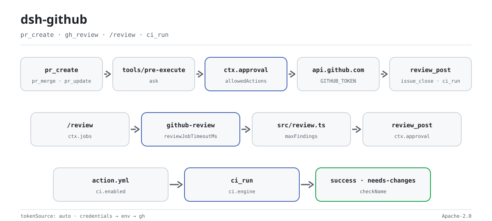

<div align="center">

<picture>
  <source media="(prefers-color-scheme: dark)" srcset="docs/assets/dsh-github-flow-dark.svg">
  
</picture>

# dsh-github

**Escreva no GitHub a partir do agente com segurança: toda gravação passa primeiro por aprovação humana e o token nunca chega a um log.**

Um plugin de host para o DeepSeek Harness que conecta PRs, revisões, issues e CI: 15 ferramentas, 4 famílias de comandos, jobs de revisão em segundo plano, uma ação composta de CI e uma barreira de status-check.

[Instalação](#instalação-em-três-passos) · [Configuração](#configuração) · [FAQ](#faq) · [简体中文](README.md) · [English](README.en.md) · [Español](README.es.md) · [Português](README.pt.md) · [हिन्दी](README.hi.md)

[](LICENSE)
[](#compatibilidade)
[](https://www.npmjs.com/package/@perrylink/dsh-github)
[](https://github.com/PerryLink/dsh-github/actions/workflows/ci.yml)
[](#compatibilidade)

[](https://github.com/PerryLink/dsh-github/stargazers)
[](https://www.npmjs.com/package/@perrylink/dsh-github)
[](https://dshfind.com/plugins/PerryLink/dsh-github?ref=badge)
[](https://securityscorecards.dev/viewer/?uri=github.com/PerryLink/dsh-github)
[](https://dsh.market/)
[](https://gitee.com/perrylink/dsh-github)

```sh
dsh plugin --profile <name> add @perrylink/dsh-github
```

</div>

<sub>Plugin da comunidade, não afiliado à DeepSeek. Repositório canônico: <https://github.com/PerryLink/dsh-github> (o Gitee é um espelho). É publicado no npm como `@perrylink/dsh-github`; o nome simples `dsh-github` pertence a outro projeto não relacionado. Migrado para [dsh-github-bot](https://github.com/PerryLink/dsh-github-bot): este repositório fica como índice/backup, o pacote npm antigo `@perrylink/dsh-github` está obsoleto — para trabalho novo instale `dsh-github-bot`.</sub>

## O que é

`dsh-github` coloca o GitHub dentro do turno do agente e, ao mesmo tempo, amarra cada gravação a uma aprovação: ferramentas como `pr_create`, `pr_merge`, `review_post` e `issue_close` só chegam ao GitHub depois que `ctx.approval` devolve um sim explícito. As superfícies de leitura — metadados de PR, diff truncado, arquivos, busca e checks — respondem sem perguntar. `/review` roda um analisador determinístico de vários arquivos como job em segundo plano em `ctx.jobs`, e o lado de CI traz uma ação composta, um bot de revisão por polling e uma barreira de status-check. O token é resolvido por operação na camada de credenciais, no ambiente ou na CLI `gh`, enviado apenas no cabeçalho `Authorization` e nunca aparece em logs, eventos, cards, saídas de comandos ou erros.

## Instalação em três passos

1. **Instale** (escolha um canal):

   ```sh
   # canal git (último main; equivale a git+https://github.com/PerryLink/dsh-github.git)
   dsh plugin --profile web add github:PerryLink/dsh-github
   # canal npm (versões publicadas)
   dsh plugin --profile web add @perrylink/dsh-github
   # canal tarball: pnpm pack neste repositório e depois
   dsh plugin --profile web add ./perrylink-dsh-github-<version>.tgz
   ```

   O script `prepare` compila apenas com dependências de produção, então o canal git não precisa de preparação extra.

2. **Configuração mínima** (os padrões funcionam; fixe a fonte do token se precisar):

   ```yaml
   - insert:
       - id: dsh-github
         name: '@perrylink/dsh-github'
         config:
           tokenSource: auto
           autoCommit: false
   ```

   `tokenSource: auto` tenta o campo da página Plugins → o arquivo de credenciais → o ambiente → a CLI `gh`, nessa ordem; o token nunca entra neste YAML.

3. **Verifique que monta**:

   ```sh
   dsh --profile web --dump-config | grep -A3 'id: dsh-github'
   ```

   Uma linha com `id: dsh-github` significa que o plugin montou; a primeira gravação passa por aprovação.

**Desinstalar**: `dsh plugin --profile web remove @perrylink/dsh-github` (ou remova a linha do patch de perfil).

<details>
<summary>Instalar a partir do mercado do DSH Desktop</summary>

Todos os plugins PerryLink podem ser explorados no mercado integrado do DSH Desktop: **Market → Sources → add source → colar** `https://perrylink-dsh-catalog.perrylink.workers.dev/catalog-source.json` **→ selecionar**. A instalação continua passando pela verificação de identidade npm do mercado e pela sua confirmação.

</details>

### Exemplos

São os pontos de entrada reais; instale e chame um.

**Exemplo detalhado** — comando `pr_create`, entrada:

```json
{
  "title": "feat: shiny",
  "body": "desc"
}
```

Saída:

```text
created pull request #7: https://github.com/o/r/pull/7 (main ← feat/shiny)
```

*Observed from `plugins/dsh-github/test/tools.test.ts:69-74 (fixture + assertions); renderer at plugins/dsh-github/src/tools.ts:189`*

**Ramo de falha** — sem nenhum token utilizável, entrada:

```text
{"title":"x"} (credentials seam empty; GITHUB_TOKEN unset; gh not logged in)
```

Saída:

```text
{
  "status": "error",
  "code": "no-token",
  "message": "no GitHub token found (source: credentials/env/gh)",
  "guidance": "Configure one of: 1) a dsh credential for this reference (recommended; $DSH_HOME/.credentials.yaml), 2) the same-named environment variable, or 3) `gh auth login` for the gh CLI. Set `tokenSource` in cordis.yml to pin one source."
}
```

*Observed from `plugins/dsh-github/src/credential.ts:96-104; plugins/dsh-github/test/tools.test.ts:88-93`*

**Exemplos breves**: `pr_merge` · `gh_review`

## Capacidades principais

O `dsh-github` preenche a lacuna do GitHub entre o `dsh` e ferramentas como Claude Code e Codex: o agente pode ler, revisar, abrir, atualizar e mesclar pull requests, ler metadados de repositórios e arquivos, comentar e fechar issues, e pesquisar — enquanto um humano aprova toda gravação e o token permanece em segredo.

- **15 ferramentas** — `pr_create`, `pr_merge`, `pr_update`, `gh_review`, `review_post`, `gh_issue`, `issue_open`, `issue_comment`, `issue_close`, `gh_search`, `gh_repo`, `gh_file`, `gh_repo_search`, `gh_checks`, todas com JSON canônico via `defineTool`, mais a ferramenta de execução única `ci_run` quando `ci.enabled` está ligado.
- **4 famílias de comandos** — `/pr create`, `/review` (start/stop/post), `/issue open` e `/ci` (scan/status/start/stop/run) sob `ci.enabled`.
- **Ciclo de vida completo do PR** — criar → revisar → atualizar (título/corpo/estado/rama base) → mesclar (merge/squash/rebase, exclusão opcional da rama head).
- **Revisões inline** — `review_post` publica um único comentário de resumo ou comentários de revisão ancorados por linha no commit head do PR.
- **Gravações com aprovação** — toda gravação no GitHub passa por `ctx.approval` (padrão `ask`, falha fechada); os motivos de aprovação pré-visualizam títulos, tamanhos de corpo e substituições de comentários.
- **Sigilo do token** — camada de credenciais → ambiente → CLI `gh`, resolvido por operação, nunca em logs, eventos, renderizações ou erros.
- **Jobs de revisão em segundo plano** — `/review` roda em `ctx.jobs` com a própria superfície `job_list` / `job_output` / `job_kill` do host.
- **Resiliência** — nova tentativa em 429 com backoff `Retry-After`/`x-ratelimit-reset`; as ferramentas de leitura são seguras para concorrência; todas as chamadas respeitam o cancelamento.
- **Superfície de CI** — a ferramenta de execução única `ci_run`, um bot de revisão por polling e uma barreira de status-check (ação composta `action.yml`).

### Ferramentas e superfícies

| Superfície | Tipo | Observações |
|---|---|---|
| `pr_create` | ferramenta | Cria uma pull request (gravação; com aprovação) |
| `pr_merge` | ferramenta | Mescla uma PR (merge/squash/rebase, exclusão opcional da rama head) |
| `pr_update` | ferramenta | Atualiza uma PR (título/corpo/estado/rama base) |
| `gh_review` | ferramenta | Lê uma PR: metadados, diff limitado, comentários, CI, achados estáticos |
| `review_post` | ferramenta | Publica um comentário de revisão (resumo ou inline ancorado por linha) |
| `gh_issue` | ferramenta | Lista / obtém / comenta issues (PRs marcados `kind: "pr"`) |
| `issue_open` | ferramenta | Cria um issue |
| `issue_comment` | ferramenta | Comenta um issue ou PR |
| `issue_close` | ferramenta | Fecha um issue (motivo de estado opcional) |
| `gh_search` | ferramenta | Pesquisa issues e PRs (cota de busca separada) |
| `gh_repo` | ferramenta | Lê os metadados do repositório |
| `gh_file` | ferramenta | Lê um arquivo em uma rama/tag/commit |
| `gh_repo_search` | ferramenta | Busca GraphQL de repositórios (cota de busca separada) |
| `gh_checks` | ferramenta | Checks de status GraphQL de um PR (check runs + commit statuses) |
| `/pr create` | comando | Lê o estado do git e enfileira uma instrução `pr_create` |
| `/review` | comando | Inicia / para / publica um job de revisão em segundo plano |
| `/issue open` | comando | Enfileira uma instrução `issue_open` |
| `/ci` | comando | Driver de CI: scan / status / start / stop / run (`ci.enabled`) |
| `ci_run` | ferramenta | Revisão CI de execução única conduzida pela ação composta / driver CI |
| bot de revisão | superfície | Bot de revisão por polling com comentários inline idempotentes (`ci.*`) |
| barreira de status-check | superfície | Publica o veredito `success` / `needs-changes` por commit head de PR (`action.yml`) |

### Arquitetura

- **Camada de credenciais.** `tokenSource: auto` resolve por operação na ordem camada de credenciais (referência `GITHUB_TOKEN`) → variável de ambiente → token da CLI `gh`. O valor é uma variável local entregue ao cliente REST; ele nunca entra em valores canônicos, renderizações, cards, saídas de comandos, avisos injetados, saídas de jobs, motivos de aprovação ou mensagens de erro.
- **Barreira de aprovação.** Todas as gravações passam pelas ferramentas do modelo. Um listener waterfall `tools/pre-execute` retorna `ask` para as ferramentas de gravação, de modo que o registro pergunta ao humano por meio de `ctx.approval` (o host registra o par de auditoria `approval/asked` + `approval/decided`) e falha fechado sem um respondedor. Comandos nunca gravam diretamente: um comando de gravação coleta contexto somente leitura e então acorda o agente para que o modelo execute a ferramenta com aprovação dentro de um turno.
- **Job de revisão em segundo plano.** `/review <pr>` inicia um job `github-review` em `ctx.jobs`; o job busca metadados (capturando o SHA do commit head para a publicação inline), o diff limitado, as verificações de CI e os comentários existentes, e então executa o analisador determinístico de múltiplos arquivos (`src/review.ts`). O job pertence ao `SessionId` puro do agente que chama — o `0.1.7-alpha.1` fecha o registro sobre `SessionId`, sem união com `Agent` —, então `dsh-tool-jobs` precisa estar composto ou `start` recusa. Com `reviewMode: "model"`, o job entrega o diff limitado a um subagente de uso único pela seam `subagents` do host. A conclusão chega à sessão por meio do consumidor `dsh-tool-jobs` do host; o modelo a lê com `job_output` e a publica com `review_post`.
- **Ação composta de CI / bot de revisão / barreira de status-check.** O repositório inclui uma ação composta (`action.yml`) que revisa PRs, corrige CI e escreve o relatório; um bot de revisão por polling publica comentários inline idempotentes; e uma barreira de status-check publica o veredito por commit head de PR. A ferramenta de execução única `ci_run` conduz a execução headless. Toda gravação permanece sujeita a aprovação.

## Configuração

Todos os ajustes são campos `Config` do Schemastery (modificáveis a partir do cordis.yml). Uma substituição direcionada por id troca toda a linha — redeclare cada chave de que você precisa. O `cordis.patch.yml` documenta cada chave em linha. Na GUI, o **cartão de configurações da página Plugins** (grupo Official) lê `tokenRef` do próprio formulário de configuração da entrada — o host `0.1.7-alpha.1` removeu a vinculação `ctx.settingsScope` e a costura de registro de namespace por trás dela, então o cartão não possui mais um namespace de configuração. O token em si é o campo `githubToken` da entrada: o cartão o grava ali e a metade host o resolve antes do arquivo de credenciais, do ambiente e do CLI gh.

Chaves mais usadas:

| Chave | Padrão | Significado |
|---|---|---|
| `tokenSource` | `auto` | `auto` (campo da página → credenciais → ambiente → gh) ou um de `config` / `credentials` / `env` / `gh` |
| `tokenRef` | `GITHUB_TOKEN` | Referência da camada de credenciais / nome da variável de ambiente |
| `githubToken` | — | Token salvo pela página Plugins; texto puro na configuração do perfil, usado primeiro enquanto não estiver vazio |
| `defaultOwnerRepo` | — | Fallback `owner/repo` quando uma chamada não nomeia nenhum e o git não tem origin |
| `autoCommit` | `false` | Se `/pr create` pode instruir o modelo a fazer commit + push primeiro |
| `maxDiffChars` | `8000` | Limite de caracteres para diffs de PR lidos nas revisões |
| `reviewMode` | `static` | Motor de revisão: `static` (analisador determinístico) ou `model` (subagente de uso único pela seam `subagents` do host; falha em alto e bom som quando a seam está ausente) |
| `ci` | `{ enabled: false, … }` | Seção de integração CI: bot de revisão por polling, barreira de status-check e a ferramenta de execução única `ci_run` (contém todas as chaves `ci.*`) |

<details>
<summary>Tabela de configuração completa (23 chaves)</summary>

| Chave | Padrão | Significado |
|---|---|---|
| `tokenSource` | `auto` | `auto` (campo da página → credenciais → ambiente → gh) ou um de `config` / `credentials` / `env` / `gh` |
| `tokenRef` | `GITHUB_TOKEN` | Referência da camada de credenciais / nome da variável de ambiente |
| `githubToken` | — | Token salvo pela página Plugins; texto puro na configuração do perfil, usado primeiro enquanto não estiver vazio |
| `defaultOwnerRepo` | — | Fallback `owner/repo` quando uma chamada não nomeia nenhum e o git não tem origin |
| `autoCommit` | `false` | Se `/pr create` pode instruir o modelo a fazer commit + push primeiro |
| `maxDiffChars` | `8000` | Limite de caracteres para diffs de PR lidos nas revisões |
| `renderExcerptChars` | `2000` | Limite de caracteres para o trecho de diff renderizado na saída da ferramenta |
| `maxComments` | `20` | Limite para comentários de PR listados por `gh_review` |
| `reviewJobTimeoutMs` | `600000` | Prazo para um job de revisão em segundo plano (falha com `timeout`) |
| `maxReviewRecords` | `50` | Limite para registros em memória de jobs de revisão; os registros concluídos mais antigos são removidos primeiro |
| `maxFileChars` | `12000` | Limite de caracteres para o conteúdo de arquivos lido por `gh_file` |
| `maxFindings` | `50` | Limite de achados do analisador por revisão |
| `maxLineLength` | `300` | Comprimento de linha a partir do qual o analisador marca um achado de linha longa |
| `reviewMode` | `static` | Motor de revisão: `static` (analisador determinístico) ou `model` (subagente de uso único pela seam `subagents` do host; falha em alto e bom som quando a seam está ausente) |
| `modelReviewProvider` | — | Nome do provedor de subagente para `reviewMode: "model"`; usa, por padrão, o primeiro provedor registrado |
| `maxRetries` | `3` | Tentativas de nova tentativa em 429 por requisição |
| `retryBaseMs` | `500` | Base do backoff de nova tentativa (dobra a cada tentativa) |
| `retryMaxWaitMs` | `60000` | Teto do backoff de nova tentativa |
| `requestTimeoutMs` | `30000` | Timeout rígido por requisição; aborta o fetch ao exceder |
| `apiBaseUrl` | `https://api.github.com` | URL base da API REST do GitHub (GitHub Enterprise) |
| `allowedActions` | `['pr.create','pr.merge','pr.update','review.post','issue.create','issue.comment','issue.close','ci.run']` | Allowlist de ações de gravação; qualquer outra coisa é negada antes da aprovação |
| `workspaceDir` | process cwd | Diretório de trabalho para inspeção somente leitura do git |
| `ci` | `{ enabled: false, … }` | Seção de integração CI: bot de revisão por polling, barreira de status-check e a ferramenta de execução única `ci_run` (contém todas as chaves `ci.*`) |

</details>

Exemplo de substituição no patch de perfil:

```yaml
- insert:
    - id: dsh-github
      name: '@perrylink/dsh-github'
      config:
        tokenSource: auto
        tokenRef: GITHUB_TOKEN
        autoCommit: false
        reviewMode: static
        allowedActions: [pr.create, review.post, issue.create, issue.comment, issue.close, pr.merge, pr.update, ci.run]
```

## FAQ

<details>
<summary>O plugin guarda o token? Onde ficam os dados de revisão?</summary>

O plugin nunca persiste o token: resolve um por operação na ordem de `tokenSource` e o coloca apenas no cabeçalho `Authorization`, nunca em logs, eventos, cards, saídas de comandos ou erros. A única exceção é um `githubToken` que você salva na página Plugins — ele fica na configuração do perfil como texto puro (a mesma exposição de um arquivo de credenciais); deixe-o vazio quando a configuração for compartilhada e use uma referência de credenciais, o ambiente ou `gh auth login`. Os relatórios de revisão vivem na memória do processo por job id; nada durável é gravado em disco.

</details>

<details>
<summary>O que acontece sem token ou sem respondedor de aprovação? Falha em silêncio?</summary>

Sem token, a ferramenta devolve um erro estruturado com `code: "no-token"` e três rotas de configuração. Se faltar o serviço de aprovação ou não houver respondedor, a gravação falha fechada em vez de passar. Ambos são erros visíveis, não um sucesso falso.

</details>

<details>
<summary>Ele disputa nomes de ferramenta, eventos ou slots com outros plugins?</summary>

Não. Todas as ferramentas têm namespace, ele não fornece nenhuma chave de serviço, não registra slot de cliente nem prefixo `webServer`; o evento compartilhado `tools/pre-execute` é observado com a semântica de broadcast de `ctx.on()` e cada listener delega via `next()`, então a cadeia nunca é curto-circuitada. A argumentação ponto a ponto está em «Interoperabilidade com outros plugins do DSH».

</details>

<details>
<summary>Revisão estática ou revisão com modelo?</summary>

O padrão `reviewMode: "static"` é determinístico, sem tokens e reproduzível — o certo para a maioria dos PRs. `reviewMode: "model"` entrega o diff limitado a um subagente de uso único, consome tokens e exige a seam `subagents` e um provedor registrado; se faltarem, falha em alto e bom som no carregamento.

</details>

<details>
<summary>E os limites de taxa do GitHub ou uma rede instável?</summary>

Os 429 são repetidos com backoff a partir de `Retry-After` / `x-ratelimit-reset` (`maxRetries`, `retryBaseMs` e `retryMaxWaitMs` são ajustáveis), e cada requisição tem um `requestTimeoutMs` rígido. A cota restante é exibida em todo resultado, incluindo falhas.

</details>

## Limites de segurança

- **Aprovação, não aplicação.** As gravações apenas produzem decisões `ask`/deny na camada oficial; o sandbox e os sistemas de aprovação continuam sendo a autoridade de aplicação.
- **Falha fechada.** A ausência de respondedor de aprovação degrada para a decisão mais estrita — nunca para uma passagem silenciosa.
- **O token nunca sai do processo.** É lido por operação e enviado apenas no cabeçalho Authorization; nunca é registrado, renderizado, injetado nem aparece em erros.
- **Sem gravações fora da aprovação.** `/pr create` nunca faz commit ou push por conta própria; com `autoCommit: true`, o modelo realiza essas gravações pela própria barreira de aprovação da ferramenta bash. O job de revisão não realiza gravações; apenas `review_post` publica, após aprovação.
- **Conteúdo não confiável é escapado e marcado.** `formatPostBody` escapa as crases e em HTML os nomes de arquivo derivados do diff, e o conteúdo externo do GitHub (arquivos, corpos, comentários, resultados de busca) é marcado como externo nas renderizações.
- **Trabalho limitado e limites de taxa.** Os 429 são repetidos com backoff; a cota restante é exibida em todo resultado, incluindo falhas.

## Permissões e dados

- **Permissões**: as gravações usam a camada de aprovação oficial; nada é reimplementado nem contornado. O plugin declara `network:outbound` e `filesystem:write` em seu manifesto de workshop.
- **Dados**: o relatório de revisão vive na memória do processo, indexado pelo id do job; nada durável é gravado em disco.
- **Log de sessão**: o plugin não adiciona tipos de evento de sessão personalizados; todo conteúdo visível ao modelo flui por superfícies registradas pelo host (`tool/result`, `user/message`, `command/run`, `approval/asked`…). Os avisos que os comandos enfileiram carregam o kind de origem próprio do plugin, `{ kind: 'dsh-github', form: 'notice', summary }` — o host não tem um kind `plugin` genérico e sua rota de admissão do formato de sessão o recusa de imediato.

## Limitações conhecidas

- **Sem eventos de sessão personalizados** — deliberado (veja Arquitetura); as trilhas de auditoria dependem do próprio vocabulário de eventos do host.
- **Analisador estático por padrão** — regras determinísticas (`src/review.ts`), zero tokens, reproduzível. `reviewMode: "model"` consome tokens e requer a seam `subagents` e um provedor registrado.
- **Jobs e registros são locais ao processo** — o relatório de revisão vive na memória do plugin, indexado pelo id do job; o mapa de registros é limitado por `maxReviewRecords` (os registros concluídos mais antigos são removidos primeiro).
- **As dist-tags `latest` do npm estão desatualizadas** — instale por meio do fechamento de perfil que o `dsh-base` fornece; nunca com um simples `npm i @deepseek-ai/dsh-tools`.

## Interoperabilidade com outros plugins do DSH

Verificado contra **DSH `0.2.0-rc.2`** (o runtime para o qual este README é publicado) e o conjunto de plugins com mais estrelas pesquisado em 2026-10-05.

Este plugin **não interfere** em outros plugins, incluindo os de mais estrelas:

- **Sem colisão de nome de ferramenta.** Todas as ferramentas têm namespace; nenhuma ocupa um nome puro já pertencente a uma ferramenta embutida ou a outro plugin.
- **Sem colisão de chave de serviço.** Não fornece nenhuma chave de serviço, portanto não pode colidir em uma.
- **Sem colisão de slot.** Não registra nenhuma chave de slot de cliente, então não disputa um assento `shadows-shipped-ui`.
- **Sem colisão de rota HTTP.** Não registra nenhum prefixo `webServer`.
- **Sem colisão na camada de patch.** O patch do bundle apenas faz `insert` da própria linha; nunca sobrescreve o `config` de uma linha embutida.
- **Sem mutação global.** Não altera protótipos, não reescreve `process.env` nem substitui o dispatcher global de fetch.

**Listeners de eventos compartilhados não interferem por construção.** Observa o evento sensível à ordem `tools/pre-execute` com `ctx.on()` — o registro de difusão do Cordis, onde cada listener executa e nenhum pode privar outro do turno. **Todos os listeners aqui delegam via `next()`**, então a cadeia nunca é curto-circuitada, e a mutação é aplicada ao valor que `next()` produziu em vez de ser devolvida no lugar dele:

- `tools/pre-execute` — also used by `cc-safety-net` (1576★).

Evidência estática: `dsh-plugin-doctor` K10–K13 retornam `pass` em todas as verificações deste repositório.

## Compatibilidade

| Superfície | Status |
|---|---|
| Harness | DeepSeek Harness `dsh-v0.2.1-rc.2` (verificado 2026-10-18): `engines.dsh >=0.2.1-0 <0.3.0`; os caminhos de compatibilidade P0 têm testes de regressão. |
| Node | `^22.19.0 \|\| >=24.0.0` |
| Plataformas | Todas (plugin host; rede de saída para o GitHub) |
| Modelo | Qualquer (a revisão estática é determinística; `reviewMode: "model"` é opcional) |

## Ecossistema e qualidade

- [Espelho no Gitee](https://gitee.com/perrylink/dsh-github) (espelho sincronizado; o GitHub é a fonte canônica)
- [Página do plugin no dshfind](https://dshfind.com/plugins/PerryLink/dsh-github) (instalações e ranking)
- [Relatório do OpenSSF Scorecard](https://securityscorecards.dev/viewer/?uri=github.com/PerryLink/dsh-github) (conduzido por [.github/workflows/scorecard.yml](.github/workflows/scorecard.yml))
- [Relatório de verificação do dsh-plugin-doctor](https://github.com/PerryLink/dsh-plugin-doctor#verified-徽章) (K10–K13 todos `pass`)
- [DSH Market](https://dsh.market/) (listado)
- **Canal 1024 store**: `npm i -g dsh1024` uma vez, depois `dsh1024 plugin --profile web add @perrylink/dsh-github` (conta para o ranking de instalações do [deepseek1024.com](https://deepseek1024.com))
- [Base de conhecimento do ecossistema](https://perrylink.github.io/dsh-plugin-guide/) — dados medidos, não marketing: guia de desenvolvimento de plugins · dados de seleção · critérios de manutenção

## Desenvolvimento

```sh
pnpm install             # node ^22.19 || >=24
pnpm run build           # tsc --noEmitOnError → lib/ (mais fix-dts e o bundle de cliente)
pnpm run prepare         # build autocontido para instalação via git (scripts/prepare.mjs)
pnpm run prepublishOnly  # compilar + testar antes de publicar
pnpm test                # vitest run
pnpm run typecheck       # tsc --noEmit
pnpm run typecheck:ci    # typecheck da linha publicada
pnpm run check:readmes   # cruza ferramentas e chaves de configuração nos 5 READMEs
```

`lib/` é o artefato publicado commitado no repositório; `pnpm run build` o regenera. As imagens do README são geradas por [`scripts/gen-readme-assets.py`](scripts/gen-readme-assets.py) (Python + Pillow) e podem ser reexecutadas; elas escrevem `docs/assets/dsh-github-flow-{light,dark}.svg`.

Tópicos: `dsh` · `dsh-plugin` · `deepseek-harness` · `github` · `pull-request` · `code-review` · `issue-tracker`

### Estrutura do repositório

```text
src/index.ts          plugin entry (name/inject/apply, applyWithDeps for tests)
src/config.ts         Schemastery Config
src/types.ts          local structural views of host services + Context merging
src/credential.ts     token resolution (seam → env → gh), per operation
src/github.ts         REST client: 429 retry, rate limits, diff media type
src/git.ts            read-only git inspection + origin parsing for any API host
src/review.ts         deterministic diff analyzer + sanitized comment drafting
src/jobs.ts           github-review background job producer (metadata + diff + CI + comments)
src/approval-gate.ts  tools/pre-execute ask/deny gate with write previews
src/tools.ts          the fourteen model-facing tools
src/ci/               review pipeline, polling bot, one-shot ci_run
src/commands.ts       /pr, /review, /issue
src/client.ts         browser half: the Plugins settings card
src/present.ts        pure UI-card presenters
test/                 vitest suite + mock host scaffolding + opt-in e2e smoke
cordis.patch.yml      bundle patch (one insert row)
scripts/prepare.mjs   self-contained git-install build
```

## Família e agradecimentos

Este projeto faz parte da família de plugins do DeepSeek Harness da [PerryLink](https://github.com/PerryLink) (todos Apache-2.0). Se ele for útil, **uma estrela ajuda a próxima pessoa a encontrá-lo** — nada fica bloqueado por isso.

- [@JosephTian876](https://github.com/JosephTian876) — o relatório do `lib/client.js` não empacotado (#11).
- [@womeimingzi11](https://github.com/womeimingzi11) — o relatório de registro do module-loader da metade navegador (#14); o bundle embrulhado em factory veio em versões posteriores.
- [@PerryLink](https://github.com/PerryLink) — criador e mantenedor: a superfície de ferramentas do GitHub, a barreira de aprovação, os jobs de revisão em segundo plano, a ação composta de CI, o bot de revisão, a barreira de status-check e a documentação em cinco idiomas.
- [@AraragiEro](https://github.com/AraragiEro) — o cartão de configuração do token do GitHub na página de ajustes de Plugins (#6).
- [@alexchenzl](https://github.com/alexchenzl) — convidou o plugin a ser listado no DSH Directory (#5).

<details>
<summary>Expandir todos os plugins</summary>

| Plugin | Status |
|---|---|
| **[dsh-aqua-input-check](https://github.com/PerryLink/dsh-aqua-input-check)** |  |
| **[dsh-archive-check](https://github.com/PerryLink/dsh-archive-check)** |  |
| **[dsh-auto-review](https://github.com/PerryLink/dsh-auto-review)** |  |
| **[dsh-autotier](https://github.com/PerryLink/dsh-autotier)** | 🧊 CONGELADO — ver o README do repo |
| **[dsh-bid-ca-precheck](https://github.com/PerryLink/dsh-bid-ca-precheck)** |  |
| **[dsh-bid-qual-check](https://github.com/PerryLink/dsh-bid-qual-check)** |  |
| **[dsh-cert-mcp](https://github.com/PerryLink/dsh-cert-mcp)** | 🧊 CONGELADO — ver o README do repo |
| **[dsh-checkpoint-rewind](https://github.com/PerryLink/dsh-checkpoint-rewind)** |  |
| **[dsh-click](https://github.com/PerryLink/dsh-click)** |  |
| **[dsh-composer-history](https://github.com/PerryLink/dsh-composer-history)** |  |
| **[dsh-contract-stance](https://github.com/PerryLink/dsh-contract-stance)** |  |
| **[dsh-customs-doc-check](https://github.com/PerryLink/dsh-customs-doc-check)** |  |
| **[dsh-data-quality](https://github.com/PerryLink/dsh-data-quality)** | 🧊 CONGELADO — ver o README do repo |
| **[dsh-demurrage-ledger](https://github.com/PerryLink/dsh-demurrage-ledger)** |  |
| **[dsh-doublecheck](https://github.com/PerryLink/dsh-doublecheck)** |  |
| **[dsh-drill-script-check](https://github.com/PerryLink/dsh-drill-script-check)** |  |
| **[dsh-eia-guide-check](https://github.com/PerryLink/dsh-eia-guide-check)** |  |
| **[dsh-emergency-plan](https://github.com/PerryLink/dsh-emergency-plan)** |  |
| **[dsh-essay-rubric-check](https://github.com/PerryLink/dsh-essay-rubric-check)** |  |
| **[dsh-evidence-check](https://github.com/PerryLink/dsh-evidence-check)** |  |
| **[dsh-export-ctl-check](https://github.com/PerryLink/dsh-export-ctl-check)** |  |
| **[dsh-fast](https://github.com/PerryLink/dsh-fast)** |  |
| **[dsh-fmea-table-check](https://github.com/PerryLink/dsh-fmea-table-check)** |  |
| **[dsh-forecast-penalty](https://github.com/PerryLink/dsh-forecast-penalty)** |  |
| **[dsh-fund-research](https://github.com/PerryLink/dsh-fund-research)** |  |
| **[dsh-github](https://github.com/PerryLink/dsh-github)** |  |
| **[dsh-gongwen-flow-check](https://github.com/PerryLink/dsh-gongwen-flow-check)** |  |
| **[dsh-gongwen-word-check](https://github.com/PerryLink/dsh-gongwen-word-check)** |  |
| **[dsh-guard-plan-qc](https://github.com/PerryLink/dsh-guard-plan-qc)** |  |
| **[dsh-hazchem-check](https://github.com/PerryLink/dsh-hazchem-check)** |  |
| **[dsh-hazplan-check](https://github.com/PerryLink/dsh-hazplan-check)** |  |
| **[dsh-hidden-risk-map](https://github.com/PerryLink/dsh-hidden-risk-map)** |  |
| **[dsh-hs-classify](https://github.com/PerryLink/dsh-hs-classify)** |  |
| **[dsh-icd-rule-check](https://github.com/PerryLink/dsh-icd-rule-check)** |  |
| **[dsh-industry-research](https://github.com/PerryLink/dsh-industry-research)** |  |
| **[dsh-lawcite-adapter](https://github.com/PerryLink/dsh-lawcite-adapter)** |  |
| **[dsh-laya](https://github.com/PerryLink/dsh-laya)** |  |
| **[dsh-lc-doc-check](https://github.com/PerryLink/dsh-lc-doc-check)** |  |
| **[dsh-learning-gap-check](https://github.com/PerryLink/dsh-learning-gap-check)** |  |
| **[dsh-library](https://github.com/PerryLink/dsh-library)** |  |
| **[dsh-local-ai](https://github.com/PerryLink/dsh-local-ai)** |  |
| **[dsh-lsp-actions](https://github.com/PerryLink/dsh-lsp-actions)** |  |
| **[dsh-mask](https://github.com/PerryLink/dsh-mask)** |  |
| **[dsh-mcp-panel](https://github.com/PerryLink/dsh-mcp-panel)** |  |
| **[dsh-medrec-qc](https://github.com/PerryLink/dsh-medrec-qc)** |  |
| **[dsh-memento](https://github.com/PerryLink/dsh-memento)** | 🧊 CONGELADO — ver o README do repo |
| **[dsh-nsfc-form-check](https://github.com/PerryLink/dsh-nsfc-form-check)** |  |
| **[dsh-nurse-record-check](https://github.com/PerryLink/dsh-nurse-record-check)** |  |
| **[dsh-observe](https://github.com/PerryLink/dsh-observe)** |  |
| **[dsh-origin-rvc-check](https://github.com/PerryLink/dsh-origin-rvc-check)** |  |
| **[dsh-ota-review-check](https://github.com/PerryLink/dsh-ota-review-check)** |  |
| **[dsh-output-styles](https://github.com/PerryLink/dsh-output-styles)** |  |
| **[dsh-paper-doc-adapter](https://github.com/PerryLink/dsh-paper-doc-adapter)** |  |
| **[dsh-permission-rules](https://github.com/PerryLink/dsh-permission-rules)** |  |
| **[dsh-permit-report-check](https://github.com/PerryLink/dsh-permit-report-check)** |  |
| **[dsh-pipeline-check](https://github.com/PerryLink/dsh-pipeline-check)** |  |
| **[dsh-pleading-draft](https://github.com/PerryLink/dsh-pleading-draft)** |  |
| **[dsh-plugin-doctor](https://github.com/PerryLink/dsh-plugin-doctor)** | 🚫 APOSENTADO (repo arquivado) |
| **[dsh-plugin-guide](https://github.com/PerryLink/dsh-plugin-guide)** |  |
| **[dsh-plugin-kit](https://github.com/PerryLink/dsh-plugin-kit)** | 🚫 APOSENTADO (repo arquivado) |
| **[dsh-plugin-upgrade](https://github.com/PerryLink/dsh-plugin-upgrade)** | 🚫 APOSENTADO (repo arquivado) |
| **[dsh-policy-brief-draft](https://github.com/PerryLink/dsh-policy-brief-draft)** |  |
| **[dsh-power-loss-split](https://github.com/PerryLink/dsh-power-loss-split)** |  |
| **[dsh-power-ticket-check](https://github.com/PerryLink/dsh-power-ticket-check)** |  |
| **[dsh-ppap-check](https://github.com/PerryLink/dsh-ppap-check)** |  |
| **[dsh-protest-deadline](https://github.com/PerryLink/dsh-protest-deadline)** |  |
| **[dsh-railway-window](https://github.com/PerryLink/dsh-railway-window)** |  |
| **[dsh-repair-order-qc](https://github.com/PerryLink/dsh-repair-order-qc)** |  |
| **[dsh-research-report](https://github.com/PerryLink/dsh-research-report)** |  |
| **[dsh-review-reply-check](https://github.com/PerryLink/dsh-review-reply-check)** |  |
| **[dsh-rulefile-check](https://github.com/PerryLink/dsh-rulefile-check)** |  |
| **[dsh-safety-brief-check](https://github.com/PerryLink/dsh-safety-brief-check)** |  |
| **[dsh-score](https://github.com/PerryLink/dsh-score)** | 🧊 CONGELADO — ver o README do repo |
| **[dsh-session-sync](https://github.com/PerryLink/dsh-session-sync)** |  |
| **[dsh-site-log-check](https://github.com/PerryLink/dsh-site-log-check)** |  |
| **[dsh-skill-pack-security](https://github.com/PerryLink/dsh-skill-pack-security)** |  |
| **[dsh-soe-decision-check](https://github.com/PerryLink/dsh-soe-decision-check)** |  |
| **[dsh-soilwater-check](https://github.com/PerryLink/dsh-soilwater-check)** |  |
| **[dsh-sop-sync-check](https://github.com/PerryLink/dsh-sop-sync-check)** |  |
| **[dsh-spc-gbt-adapter](https://github.com/PerryLink/dsh-spc-gbt-adapter)** |  |
| **[dsh-talk](https://github.com/PerryLink/dsh-talk)** |  |
| **[dsh-tender-extract](https://github.com/PerryLink/dsh-tender-extract)** |  |
| **[dsh-tender-matrix](https://github.com/PerryLink/dsh-tender-matrix)** |  |
| **[dsh-test-drive](https://github.com/PerryLink/dsh-test-drive)** |  |
| **[dsh-ticktick](https://github.com/PerryLink/dsh-ticktick)** | 🚫 APOSENTADO (repo arquivado) |
| **[dsh-translate](https://github.com/PerryLink/dsh-translate)** |  |
| **[dsh-warranty-calc](https://github.com/PerryLink/dsh-warranty-calc)** |  |
| **[dsh-budget](https://github.com/PerryLink/dsh-budget)** | 🧊 CONGELADO — ver o README do repo |
| **[dsh-claude-move](https://github.com/PerryLink/dsh-claude-move)** | 🧊 CONGELADO — ver o README do repo |
| **[dsh-defend](https://github.com/PerryLink/dsh-defend)** | 🧊 CONGELADO — ver o README do repo |
| **[dsh-draw](https://github.com/PerryLink/dsh-draw)** | 🧊 CONGELADO — ver o README do repo |
| **[dsh-reach](https://github.com/PerryLink/dsh-reach)** | 🧊 CONGELADO — ver o README do repo |
| **[dsh-background-agents](https://github.com/PerryLink/dsh-background-agents)** | 🚫 APOSENTADO (repo arquivado) |
| **[dsh-session-pin](https://github.com/PerryLink/dsh-session-pin)** | 🚫 APOSENTADO (repo arquivado) |
| **[dsh-team-rooms](https://github.com/PerryLink/dsh-team-rooms)** | 🚫 APOSENTADO (repo arquivado) |

</details>

## Licença

[LICENSE](LICENSE) (Apache License 2.0) © 2026 dsh-github contributors

<p align="center"><sub>Apache-2.0 · Plugin da comunidade, não afiliado à DeepSeek.</sub></p>
